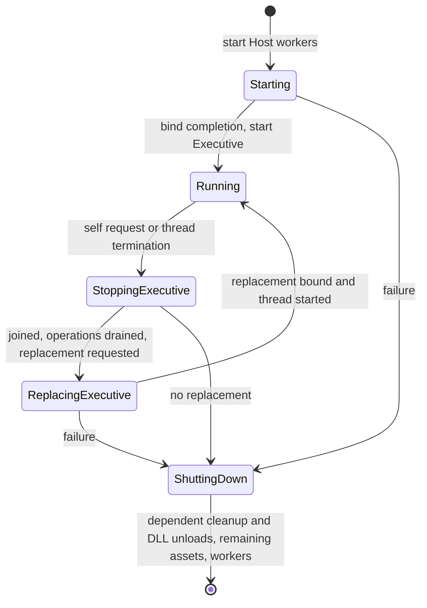

Copyright (c) 2026 Ritchie Brannan / Morphic Void Limited
License: MIT (see LICENSE file in repository root)

File:   asynchronous_module_lifecycle.md
Author: Ritchie Brannan
Drafting and editorial assistance: OpenAI Codex
Date:   21 Sep 2026

# Asynchronous module lifecycle

This reference describes the implemented Host module service, Executive startup
policy and passive, threaded and Host-pumped module lifecycles. The
[Host foundation](host_pump_foundation.md), [borrow protocol](service_borrow_lifetimes.md)
and [restriction/maintenance contract](host_restriction_maintenance.md) specify
the generic execution and lifetime boundaries in detail. Completion history and
validation evidence are recorded in [completed milestones](../project/completed_milestones.md).

Module loading, binding, context installation, compatibility
checks and unloading execute on the Host I/O worker. All Host background workers
use the same handlers. With one configured worker, it shares I/O and conditioning;
with more than one, the first handles I/O and the rest handle conditioning.

## Current identity catalogue

The module catalogue contains `executable`, `executive`, `conditioning_general`,
`rendering`, `audio` and `platform`, at the `executable`, `executive`, `conditioning`,
`render`, `audio` and `platform` mounts respectively. The conditioning module and
`simulation` thread identities support independent-service lifecycle fixtures. The production renderer's identity
is backend-neutral. The batch-runner thread range remains contiguous and covers
all 32 supported runners. Audio advertises its service thread; Platform advertises
Host pumping and has no native service thread or fabricated thread package.

Pre-release catalogue ordinals are not a compatibility promise. Removing entries
changes encoded identities and dependency bits, so clean-build all components and
fixture DLLs together and use fresh validation runtimes. The binding ABI version
alone does not detect a mismatched catalogue. No reserved type slots are retained
solely to preserve earlier pre-release numbering.

## Startup and Executive transitions

The Host starts its configured workers and builds the filesystem image on its file I/O
worker before requesting the Executive DLL. Its normal
message loop receives the binding completion and then creates the Executive
thread. Per-thread context installation still runs on the newly created thread,
because that operation installs thread-local state.

The [bootstrap configuration file](../project/bootstrap_configuration.md) requires
`executive=<logical module filename>` to select the implementation advertising the
Executive identity and exporting the Executive thread function. The checked-in
flow-test presets select `package:/bin/MorphicExecutive.${module_extension}`.
The bootstrap reader expands the token to the native extension before requesting the module.
The [development filesystem image](../../development/README.md#build-output-redirect)
resolves discovered DLLs adjacent to the running executable without copying them.

Rendering selection belongs to the Executive. The Host bootstraps only the
Executive; a selector implementation can run without a renderer or choose another
implementation later. The normal Executive first sends an owning load request
for `package:/bin/MorphicRendering` with the native extension appended by
`platform::module::make_module_filename`, and `rendering`. It validates
the correlated acknowledgement before accepting completion, then asks Rendering
to run its own tests through `RunTestsRequest` on a negotiated direct connection.
After completion and connection retirement, it loads `MorphicAudio` and
requests its finite tone acceptance test. Audio success or explicit no-output-device
`unavailable`/skipped completion permits the general asset acceptance flow (currently
73 sequential and 32 concurrent operations). Other Audio failures fail startup.
See the [Audio validation record](audio_module_validation.md). The normal flow
does not load Platform or create a window.

After Executive replacement, `already_loaded` is accepted only for the requested
Rendering/Audio identity with `available == true`; no extra thread, unload or replacement
is requested. Missing/unavailable services, failed completion and malformed
startup replies cause an Executive self-unload request. Initial request-submission
failure still marks Executive startup failed. The existing per-operation deadline
also covers the acknowledgement/completion phases and waiting for Host-requested
exit; there is no retry policy.

On receiving an Executive unload or replacement request, the Host immediately
sets that thread's exit-request state and wakes it. This happens before validation
or waiting for other work. The outgoing Executive receives neither acknowledgement
nor completion for that request. It must still return through its normal exit
path; the Host joins it before unloading the DLL. The Host also drains accepted
operations and disposes of the old thread package, including queued messages.

Self-unload without replacement requests full system shutdown. Self-replacement
keeps independent retained assets, cleans up assets dependent on the outgoing
Executive, unloads it, binds the replacement, and starts
its thread. Failure at any replacement stage produces an error-level log and
full orderly shutdown, without rollback, retries or an outgoing notification. The
diagnostic is logged without invoking a debugger breakpoint. Bootstrap failure
uses the same failure handling.

## Ordinary DLL operations

`ModuleRequest` owns its logical filename (for example
`package:/bin/MorphicRendering.dll` on Windows or `package:/bin/MorphicRendering.so`
on Linux) and carries an action (`load`, `unload`, or
`replace`), a registered module identity and an optional required function identity.
The mounting point encoded in the module identity selects the service being
changed. A replacement may select another registered implementation at that point.
Unload must identify the currently loaded implementation.

The Host sends two correlated `ModuleResult` notifications for requests concerning
other DLLs:

1. `acknowledged`: receipt for processing, before validation or worker execution.
2. `completed`: success or failure, with the available implementation and optional
   borrowed function pointer when applicable.

Acknowledgement does not establish readiness or permit renewed use. There is one
pending module operation at a time. A further ordinary request receives
acknowledgement followed by a `busy` completion. This is intentionally bounded;
there is no additional module-operation queue or automatic retry policy.

Successful completion means loading, binding, installation and any required
function lookup have all succeeded. A threaded service must publish readiness;
a pumped service must reach ready through activation/pumping. The original binding
ABI, version and unsupported-function checks are retained. Failed installation is cleaned up by the
same worker. Replacement unloads the old implementation before loading the new
one. If the new load fails, the service remains unavailable. If unloading itself
is refused, the old binding remains present and the result reports that state.
A rendering binding whose thread was stopped is reported unavailable even if
unbinding fails; no automatic restart or rollback is attempted.

Every live module client can issue ordinary module requests; Executive is not the
exclusive requester. Each installation has an exact instance/client identity, and
a replacement cannot inherit replies, acquisitions or borrows. Loading establishes
no persistent loader ownership. Open provider routes make ordinary unload or
replacement busy; only Executive itself or Host lifecycle handling can use its
special self-transition path. Ordinary non-Executive self-transitions are rejected.

The requesting client must quiesce its use of the affected DLL until completion.
The default Executive response to a failed module operation is a self-unload
request, causing system shutdown. More selective recovery is left to future
Executive policy.

## Rendering DLL and thread

`MorphicRendering.vcxproj` is a separate solution project producing
`MorphicRendering.dll`; the CMake build produces `MorphicRendering.so` on Linux.
It uses the `rendering` module
identity at the `render` mount on both Windows and Linux, with the existing
`rendering` thread identity.
Vulkan is the chosen backend; the module identity does not encode that choice.
This stage contains no graphics API calls, graphics resources or actual rendering.

An ordinary owning `ModuleRequest` loads the DLL. Rendering advertises its
service thread through the generic capability described below. The normal
Executive requires that capability when selecting Rendering. The entry point
verifies the installed thread context, publishes readiness, and services
requests and batch completions until accepted work drains during exit.
Selector Executives may omit Rendering entirely. The existing
`rendering_thread_function` query remains available to explicit callers.

Rendering load/replacement keeps the module operation pending through thread
startup. A failed startup joins and destroys its package, then dispatches
unbind/unload back to the I/O worker before delivering the failure completion.
It reports `installation_failed` when that cleanup succeeds, or the cleanup
failure otherwise. Both acknowledgement and completion retain the original
client correlation.

Rendering unload/replacement requests exit and observes the terminal state
before draining the thread's final requests. The stopped package and its reply
transports remain alive until all accepted asset operations, including deferred
disposal replies, have completed. The Host then joins and destroys the package,
disposes remaining dependent assets, and dispatches unbinding. Full shutdown uses the
same path. Ordinary rendering transitions neither request Executive exit nor
suppress its replies. A loaded rendering thread survives Executive replacement
until a rendering request or full system shutdown stops it.

The real stub replaces the successful service fixture in lifecycle validation.
The test Executive, deliberate missing-export/failed-startup DLLs, and a rendering
fixture that posts disposals during exit remain fixtures; production rendering
contains no test switches.

## Module service threads

A module may export `morphic_module_service_thread_v1(SServiceThread*)`, returning
`EBindingResult::success` and a descriptor containing its thread identity and
entry point. This optional, versioned export leaves the version-3 bootstrap ABI
and the identity catalogue unchanged by that export itself. Modules with neither
service-thread nor Host-pump capability remain passive. A caller can set
`ModuleRequest::require_service_thread` to reject a passive destination with
`function_unavailable`, including an already loaded
passive module. An existing passive binding remains available after that rejection.

The I/O worker queries the capability after installation. A successful descriptor
must have a non-null entry point and a valid, registered thread identity; malformed
descriptors fail loading. Host starts one normal-priority service thread per
advertising module, using its stable binding, memory context and batch client.
It tracks packages by module identity, so several modules may have independent
service threads. Executive retains its separate bootstrap and system-control
role and cannot also advertise an ordinary service thread.

Readiness completes the pending load or replacement. Failed startup joins the
package and schedules worker-side unbinding before reporting failure. Host
routes owning asset requests from every registered service and samples every
service's state before draining final messages and releasing abandoned
acquisitions. Unload and replacement protect active test callers/workers, wait
for accepted asset work and batch publishers, join the service, dispose dependent
assets, and only then unbind. Executive replacement preserves the other services;
system shutdown requests their exit so they can release acquisitions before
the module unload sequence proceeds.

Lifecycle fixtures run a `conditioning_general` service with the `simulation`
thread identity alongside Rendering. They cover passive capability rejection,
malformed descriptors, failed startup, replacement and shutdown with retained
acquisitions, deferred disposal and dependent-asset cleanup.

## Host-pumped services

The independent `morphic_module_host_pump_v2` export advertises a complete
`modules::SHostPumpV2` lifecycle. The binding worker discovers/validates it, then
Host prepares module-local context and invokes activate, pump, stop and deactivate
on the Host thread. A module cannot advertise both threaded and pumped execution;
`require_host_pump` is separate from `require_service_thread`. The generic service
advertisement is independent of execution, although the current provider adapter
supports pumped execution only. Threaded consumers already use the same service
and borrow protocols.

Platform is an on-demand pumped provider. Binding/activation creates no window;
explicit service commands create or acquire the first Windows window. Its native
callbacks perform only authenticated bounded maintenance while restricted, with
ordinary dispatch and owner destruction deferred until safe outer progress. See
the [first-window reference](platform_first_window.md).

## Module test conversations

Executive runs Rendering and Audio tests through negotiated
[direct POD connections](direct_pod_connections.md). The Framework contract in
`framework/communications/module_tests.hpp` defines `RunTestsRequest` and
`RunTestsResult`; each module validates its own destination, correlation, status
and counts. Host establishes and retires the connection but does not forward or
interpret test payloads. Each service admits one local run at a time.

Normal conversations consume their final result before closing. Explicit unload,
replacement and shutdown close the connection and cancel unfinished work. No
synthetic test completion is required for retirement. Rendering drains dependent
asset releases, disposals and batch work; Audio stops its device. Endpoint storage
and notification pins remain alive until both participants relinquish them, or
Host proves an abandoned participant's final queue drain and native join.

Lifecycle fixtures exercise Rendering as caller and Executive as worker, final
replies, worker exit without a reply, and caller unload during a conversation.
Platform remains a pumped service and uses service commands rather than this
service-thread test contract. Its shell fixtures check repeated unsupported
commands and orderly unload; native acceptance uses explicit external harnesses.

## Ownership, dependencies and shutdown

The Host owns address-stable module records, their memory contexts and the owning
request envelope. `ModuleWorkRequest` borrows one stable job from the Host. Only the
worker mutates its binding objects until the completion is received. The job's
filename, registry, debug service and contexts outlive that borrow. Clients send
identities and owned filenames; they do not send borrowed binding objects into
the Host.

Worker jobs begin only after pending asset operations have drained. Asset transfers
preserve their explicit mounting-point dependency flags in the retained Host
carrier. Once a module's thread has exited and been joined, and asset operations
have drained, the Host expects no retained assets to depend on that module. If
any remain, it emits an assertion-level diagnostic and disposes of them before
dispatching unbind/unload to the I/O worker. This diagnostic does not trigger a
debugger breakpoint or cancel unloading. Independent assets remain retained.
The Executive and threaded services have Host-managed threads; pumped services
retain their execution context and provider storage without a thread package.
Callers must still quiesce their own use of affected DLL functions and borrowed views before
requesting unload or replacement.
Existing module memory-attribution checks also remain enforced. Generic
[borrow records](service_borrow_lifetimes.md) protect provider and consumer instances
through explicit quiescence and final provider cleanup, including notification
publishers. Terminal execution proves CPU inactivity only, not external graphics
cleanup. These checks do not track arbitrary cached function
pointers or introduce a general module reference-counting system.

Clients release individual retained assets with `AssetDisposeRequest`, a POD
containing only `CAssetId`. Its correlated `AssetDisposeResult` contains the ID and
success/failure status, with no borrowed views. The Host waits for already accepted
operations using the asset, rejects later saves using that ID, then destroys it.
An invalid, stale or already pending disposal ID receives `invalid_asset`.
Other borrowers must quiesce before requesting disposal; their views do not extend
lifetime. Requests can come from any connected thread package.

Original bundle IDs are the exception: only the thread instance that requested
the bake/load may close them. Closure has no correlated success reply; final
`BundleDisposedNotification` delivery follows storage destruction and virtual-root
removal. Retained sub-files can outlive that thread and remain usable after closure.
The Host detaches the bundle owner/notification route before destroying either
an Executive or Rendering package. A replacement package does not inherit the
route or management authority. Reference-only waits do not prevent module cleanup.
See the [bundle lifetime contract](../assets/bundle_specification.md#references-and-disposal).

Full shutdown stops and joins the Executive, drains operations, performs the same
assertion and dependent-asset cleanup before each module unload, then releases
remaining independent assets while the I/O worker is still running. Only
after those completions does it stop the workers and debug service. If a terminal
worker/transport failure prevents safe unloading, cleanup retains the required
Host graph, bindings, contexts and callback storage through process exit rather
than invoking unsafe destruction. Pumped stop/retirement continues while required
cleanup can progress. Expired grace periods report failure without authorising
destruction or unbinding; see the Host foundation's process-ownership contract.

## Implementation map

- `core/module/module_messages.hpp`: public module requests and notices in `modules`.
- `core/filesystem/filesystem_messages.hpp`: logical filesystem refresh messages in `filesystem`.
- `host/runtime/host_payloads.hpp`: private worker exchange, registered in the
  Host's LOCAL catalogue (and separately in the service-test binary).
- `host/runtime/module_service.*`: admission, stable records, worker-job lifetime
  and completion routing, including thread-start completion.
- `host/runtime/host.cpp`: bootstrap, queue draining and thread/package lifetime.
- `host/runtime/client_record.*`, `pumped_client.*`, `service_router.*` and
  `service_borrows.*`: exact clients, pumped execution, routes and borrow retirement.
- `host/runtime/host_worker_thread.cpp`: shared binding/unbinding handlers.
- `rendering/module/binding/*` and `rendering/runtime/*`: module binding and the
  Rendering service, module-local tests and conditioning work.
- `executive/runtime/executive_thread.cpp`: Rendering/Audio selection and acceptance gates.
- `platform/runtime/*` and `platform/native/*`: portable pumped window service and native adapters.

## Validation

Run `tests/module_lifecycle/run_tests.ps1 -Configuration Debug -Platform x64`
from PowerShell. The script builds the solution and four roles of the standalone
`MorphicLifecycleFixture.vcxproj`, then launches isolated Host processes.
Use `Release` and/or `Win32` for other configurations; `-SkipBuild` requires all
matching solution and fixture binaries to have already been built.
Use `-SkipSolutionBuild` to build only the fixture DLLs against an existing
solution build, and `-MSBuild` to select a toolchain explicitly. Windows CI runs
the harness in each Debug/Release and x64/Win32 job with one and two requested
Host workers, retaining the isolated runtime logs and test output.

The fixture project is maintained test infrastructure outside the solution.
It produces the Executive driver, missing-thread-export, failed-thread-start
and disposal-at-exit DLLs. Successful rendering service cases use the real stub.
The production renderer contains no test switches. Adding the fixture project
to the solution for IDE visibility is not required by the harness.

The lifecycle harness covers:

- Correlated acknowledgement/completion, normal and duplicate loads, missing
  files/functions, replacement and unavailable service after failure.
- Executive bootstrap, self-shutdown without notifications, replacement and
  startup failures; selector Executives that never load rendering.
- Rendering load/unload/replacement, failed startup cleanup and Rendering identity.
  A renderer survives Executive replacement and is reused without a second thread.
- Normal Executive startup and unavailable-renderer shutdown before asset work.
  Successful startup/replacement runs the current asset acceptance flow,
  followed by filesystem refresh/cache operations and bundle persistence.
- Explicit disposal, invalid/stale IDs, saves admitted before disposal, dependent
  cleanup and preservation of unrelated retained assets.
- Disposal requests posted by rendering immediately before terminal publication:
  the final queue is drained and replies finish before package destruction.
- Bundle persistence, deterministic rebaking, virtual-root refresh/cache rules,
  post-closure sub-file saves and final-notification ordering before root reuse.
  Batch borrowers run both queued and inline while retained records protect bytes.
- A complete-view reply handled across closure, diagnosing the convention
  violation and retaining storage until that reference is disposed of.
- Executive replacement with a closed bundle held by an ordinary sub-file record;
  the replacement saves and releases it without inheriting the outgoing recipient's
  notification. Full shutdown also covers undisposed bundle records.
- Rendering-owned bundle disposal, rejection of another requester's original-ID
  disposal, and sub-file use/release after the Rendering package is destroyed.
- Malformed loads, missing inputs, an empty selection and an inventoried file
  removed before baking; every failure releases the reserved destination root.

Bundle fixtures stage boundary-sized files, empty files/directories, mixed-case
and metadata-like names, a reparse entry and an opaque copy of an existing shader.
Successful bundle cases check that Executive allocation attribution returns to
its starting baseline. The replacement fixture saves an opaque asset-ID handoff
for use only within that Host process; this is test coordination, not a persisted
asset-ID contract.

Checks include process status, notification order, saved bytes, dependency
assertions, exit/join/unload ordering, I/O-worker building and conditioning-worker
preparation (or shared-worker fallback). The rendering
exit-disposal regression allows saves to finish before disposal is requested.
When a reply is deferred, it checks deferral-to-completion ordering; in either
case, both disposal completions must precede the Rendering thread join.
Missing/failing normal-renderer tests use isolated binary copies under `build/`.

Core `MorphicTests -t1` covers dependency disposal and compact message compatibility.
Its real-Executive protocol tests exercise successful and already-loaded replies,
wrong identity/correlation, unavailable service, load failure, missing/duplicate
acknowledgement and initial submission failure. The test script and suites are
the executable coverage inventory; milestone counts describe dated runs.
