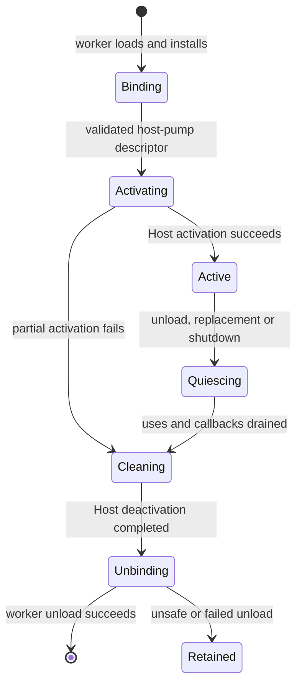

Copyright (c) 2026 Ritchie Brannan / Morphic Void Limited
License: MIT (see LICENSE file in repository root)

File:   platform_host_pumped_design.md
Author: Ritchie Brannan
Drafting and editorial assistance: OpenAI Codex
Date:   30 Oct 2026
Review: 04 Nov 2026

# Platform module and host-pumped lifecycle

## Status and scope

This document records the agreed Platform direction and historical design reviews
against `f00b2eb` and `07064fc`. As of 4 November 2026, implementation is committed
through `f55d514`; the original absence statements in the dated assessment/review
sections describe those earlier baselines, not the current checkout.

| Delivered increment | Current reference |
| --- | --- |
| Generic Host clients, pumping, routing and process ownership (`2c6d4b1`) | [Host foundation](host_pump_foundation.md) and [module lifecycle](asynchronous_module_lifecycle.md). |
| Prepared service borrows and two-sided retirement (`9db7a3d`) | [Borrow lifetimes](service_borrow_lifetimes.md). |
| Borrow-bound notification registrations (`aca926f`) | [Notifications](service_notifications.md). |
| Restriction accounting, eligible budgets and bounded modal maintenance (`078b595`) | [Restriction/maintenance contract and portable evidence](host_restriction_maintenance.md). |
| On-demand Platform shell and first Windows window (`f55d514`) | [Window interfaces, native acceptance and limits](platform_first_window.md). |

The [first-stage contracts](platform_contracts_v1.md) distinguish the implemented
subset from prospective input/configuration/mode definitions. Current headers and
the subsystem references above govern the implemented APIs: generic borrow
retirement replaces duplicate domain release opcodes, and durable window state
with notifications replaces the proposed window event messages. All components
use matching headers; the pre-release layouts are not a compatibility promise.

The 4 November connection decision separates allocation ownership: general direct
service-thread messaging uses [Host-owned duplex connections](#host-owned-duplex-connections-for-general-pod-messaging),
while input/HID keeps [Platform-owned producer streams](#platform-owned-desktop-and-controller-connections).
Each direct connection groups two bounded SPSC pipes under one identity and
coordinated lifetime. Either participant can request it; both must be ready before
Host authorises activation. Ordinary POD traffic and wake signals then pass directly.
This supersedes the earlier conversational recommendation of producer-owned general
direct pipes; neither proposal has been implemented.

Shared contracts will use the transitional [Framework project](#shared-framework-contracts)
(`MorphicFramework`). General direct connections reuse existing role identities to
identify their contract and carry the existing `CErasedPodMsg` record. Project
creation, registration changes and contract migration have not been implemented.

The next scope review must define the concrete connection controls and interfaces.
Common publication, notification and quiescence principles need not impose one
allocation owner. A minimal Host-mediated connection lifecycle versus a broader
threaded service-provider adapter remains an open implementation-design choice;
the latter is not a prerequisite selected by this decision. Owning transfers stay
via Host, and input readiness/generation barriers remain domain concerns.

The decisions in the next section and later sections explicitly marked as agreed
are settled. Concrete API names/layouts and explicitly proposed policies still
require review. Outstanding
choices are collected at the end. Audio, external AI communication and the shared
command interface are separate work; they are not added to this implementation.

The native implementation targets Windows. Linux compatibility informs the shared
contracts, but the native Linux backend remains undecided and is later work.
Window-function extensions remain deferred. Controller input is part of the
initial HID scope, with semantic actions as the application-facing baseline.
The initial local mapping vocabulary and cancellation/delivery semantics are
agreed below. Configuration uses schema-defined records, named definitions and
configuration-local IDs. GameInput is selected for Windows controller acquisition;
configuration packaging and concrete ABI details remain open.
A complete remapping UI and
native Steam Input integration are not prerequisites for the first stage.
Direct module-to-module POD messaging is an agreed future direction. Its first
service-thread connection increment is to be scoped with input lifetimes, building
on the implemented generic borrow and notification foundation.

## Agreed decisions

- Platform owns native windows, HID/input collection and native event handling.
  It creates and owns the input transports. Mouse and keyboard form one logical
  desktop-input connection, with separate translated-text and mouse/keyboard-
  control streams. Controller input has an independent connection and action
  stream. Each connection has one exclusive consumer module instance; any module
  may request either, and the desktop and controller consumers may differ.
  Executive is the expected common consumer, not a privileged routing assumption.
  Rendering can obtain the native window information required for presentation.
- Input acquisition uses explicit reservation and consumer readiness. Occupied
  connections are not implicitly queued or taken over. Release is cooperative;
  a changed consumer releases its connection and the replacement requests a fresh
  one. There is no successor nomination or reserved handover. If a removed module
  leaves a connection nominally attached without releasing it, Host logs the
  omission and completes release on its behalf after endpoint access is quiescent.
- Platform has no service thread. It advertises a host-pumped capability in a
  similar manner to the existing optional service-thread descriptor. Host drives
  it on its main thread; Platform implements native event processing.
- Platform loads only in response to an explicit module request, initially expected
  from Executive or Rendering.
  A rendering configuration that only conditions data need not load Platform or
  require a window/display connection.
- Platform follows the existing Rendering module lifecycle. There is no persistent
  ownership by the original load requester. An already loaded module is reported
  through `already_loaded` and checked for identity, required capability and
  availability. Extend generic request admission to other module clients without
  introducing an original-requester-only unload rule. Connections/window uses have
  separate lifetimes and must still quiesce before resource reclamation.
- Loading/activating Platform and creating/acquiring a window are distinct steps.
  Executive may request a standard window, or Rendering may request one when its
  selected configuration requires presentation.
- Platform owns every window. Executive and Rendering hold explicit uses; neither
  client directly destroys the other's window or owns the Platform binding.
- Initially support one application window at the default native location/monitor.
  Its desktop connection protects that window's lifetime. The controller connection
  is independent of windows and initially represents one logical player/input slot
  with one assigned device. Multiple windows, monitors and player slots are later
  extensions, not assumptions to encode as global singleton identities.
- In a later stage, a client may supply an extension to Platform's window handling.
  Platform keeps its window procedure and standard keyboard/mouse handling. The extension may
  pre-empt eligible handling, including redraw, and otherwise falls through to
  Platform's standard handler.
- The main use is full-screen Vulkan presentation, with decorated, movable and
  resizable windowed operation also supported. Explicit monitor selection is a
  later requirement; the initial setup uses the default location/monitor.
  Provide requests and keyboard shortcuts for windowed, full-screen-windowed
  (non-exclusive) and full-screen-exclusive modes. Exclusive presentation requires
  Rendering cooperation; changing window styles alone does not establish it.
- Controller input is a primary HID requirement alongside keyboard and mouse.
  Morphic consumers receive semantic actions through a common contract: native
  device state feeds a local mapper, while later native Steam Input integration
  supplies the same actions through an adapter. Physical snapshots remain a
  backend representation rather than the normal application-facing interface.
- Platform provides translated Unicode text through a separate input stream.
  Text entry, application actions and reserved coordination shortcuts have distinct
  purposes. The former plan to defer the entire controller-style mapping layer is
  superseded by the common action baseline and initial binding scope below.
- The local mapper lives in Platform, separate from native device handling.
  Executive/application data defines actions, contexts and binding profiles; the
  input subscription's consumer selects its context. Context transitions cancel
  outgoing actions, reset values to neutral and use a correlated stream marker.
  Held controls must return to neutral before reactivation.
- A shared action catalogue and binding configuration use the existing schema
  system to define configuration structures and materialise their records.
  Definitions are named instances with explicit configuration-local IDs;
  associations between records use those IDs. This does not define action-event
  payloads or map live input values into application structures.
- Initial bindings follow Steam's vocabulary, including non-consuming chords and
  explicit start/release pulses. Cancellation is distinct from normal release;
  composition, ordered delivery and discontinuity rules are specified below.
- Configuration installations are immutable. A replacement may be prepared while
  existing connections remain active; adopting it requires release and reacquisition.
- Initial text is committed UTF-8 through SuiteUTF, including native translation
  and dead-key handling. IME composition/pre-edit and relative mouse mode are
  deferred. Mouse capture is explicitly requested; modifier combinations and
  keyboard eligibility during text entry are configuration-defined.
- Windows controllers use GameInput through a private Platform adapter. Stick and
  trigger normalisation, radial dead zones, hysteresis and mapping remain shared
  concepts for future backends. Include the GameInput redistributable in deployment.
- Input queues are bounded SPSC transports. Overflow publishes durable loss state,
  cancels affected actions and recovers through a fresh baseline with neutral-before-
  reactivation. Desktop context changes coordinate markers in both desktop streams.
- Host owns pumped-module command queues and lends bounded POD batches to pump
  calls. Lifecycle operations are separate; activation and stopping may remain
  pending while subsequent pump calls progress them.
- A window's creator controls it. Ordinary OS close is asynchronously accepted or
  rejected by that client; controller exit begins closure. Engine shutdown bypasses
  the veto but never bypasses quiescence. Closing a window does not itself stop the
  engine. Mode shortcuts, busy handling and exclusive-loss recovery are defined below.
- Native modal interaction, such as move/resize, publishes a pause reason promptly
  from the native callback. Executive combines it with other application pause
  reasons. Simulation pauses without accumulating catch-up time, while control,
  cleanup and shutdown remain active.
- During native modal loops, Host performs restricted, bounded maintenance.
  Unsafe lifetime changes wait until native dispatch unwinds. Host-dependent
  operation budgets exclude the declared modal interval. Independent progress
  watchdogs continue unless their work is explicitly suspended; shutdown grace
  continues throughout the interaction.
- General direct service-thread messaging uses Host-owned duplex connections:
  two bounded SPSC pipes, one each direction, with one identity and coordinated
  lifetime. Either participant can initiate through Host, which coordinates
  acceptance, endpoint installation and readiness from both sides before activation.
  Ordinary POD messages and notifications flow directly between the participants.
  Platform input remains Platform-owned producer streams. These allocation choices
  do not transfer payload ownership, which remains exclusively through Host.
  Host remains the repository for long-lived assets, file I/O mediator and
  module load/unload coordinator.
- Host currently has no blocking wait/wakeup cycle. Host pumping can initially
  fit into that loop; a complete sleep/wake design is separate follow-on work.
- Core retains low-level platform foundations needed to load modules, create
  threads and support the runtime. Platform does not absorb those foundations.
  Core's project include boundary remains Core plus SuiteUTF only.

## Original code assessment and consequences

This table records the pre-implementation baseline at `07064fc`. The generic Host
gaps identified here were addressed by the committed stages listed above; input
transports and later features remain prospective. Linked files now contain the
newer implementation, so use Git history for the exact assessed baseline.

| Area | Existing implementation | Consequence for this work |
| --- | --- | --- |
| Optional capability | [module_binding.hpp](../../core/module/module_binding.hpp) and [bound_module.cpp](../../core/module/bound_module.cpp), `query_service_thread` | Follow its optional, independently versioned export pattern. Discover a descriptor on the worker; execute host-pumped lifecycle calls on Host. |
| Binding installation | [module_binding_context.cpp](../../core/module/module_binding_context.cpp) | Module installation and thread-local provisioning are separate. A host-pumped call needs valid module-local TLS on the Host thread. |
| Worker authority | [host_worker_thread.cpp](../../host/runtime/host_worker_thread.cpp), `perform_module_work` | Loading, binding, installation and unbinding belong to the I/O worker. Native window creation and destruction must not be added there. |
| Module availability | [module_service.cpp](../../host/runtime/module_service.cpp), `complete`, `complete_thread_start`, `finish` | Readiness currently distinguishes passive bindings from service threads. Add host activation and cleanup states before returning completion. |
| Request admission | [host.cpp](../../host/runtime/host.cpp), `receive_request` and `run` | Executive owns the current module-request route; other registered services send owning requests to the asset service. Rendering cannot yet request Platform through this route. |
| Client lifetime | [module_service.hpp](../../host/runtime/module_service.hpp), `m_client` | A pending operation borrows a `CThreadPackage*`. General routing needs explicit requester-lifetime protection through completion or cancellation. |
| Main loop | [host.cpp](../../host/runtime/host.cpp), `run` | Host drains queues and advances lifecycle, ending in `processor_relax()`. This is a spin hint, not a sleep or OS event wait. Existing queue drains are not budgeted. |
| Thread resources | [CThreadPackage.hpp](../../core/threading/CThreadPackage.hpp) | Transport, parking and native thread state are currently bundled. A pumped module must not pretend to own a native thread just to get an endpoint. |
| Tests | [host.cpp](../../host/runtime/host.cpp), `request_tests`, `complete_tests` | Generic test messages currently resolve only to service-thread packages. A pumped destination requires endpoint-based routing and termination handling. |
| Existing transports | [TRingTransport.hpp](../../core/threading/transports/TRingTransport.hpp), [TQueueTransport.hpp](../../core/threading/transports/TQueueTransport.hpp) | Reuse established transport semantics; an input pipe is not an existing Platform abstraction. Fixed rings reject full writes and require quiescence before deallocation. |
| Type admission | [erased_transport_admission.hpp](../../core/system/erased_transport_admission.hpp) and concrete erased transports | LOCAL identities do not become cross-module messages merely by forwarding them. Choose an explicit shared contract/transport boundary. |
| Unload protection | [asset_service.cpp](../../host/runtime/asset_service.cpp), `CBoundModule::unbind` | Asset acquisitions, dependency bits and allocation attribution do not account for arbitrary window uses or callbacks into another DLL. |
| Shutdown | `CModuleService::request_shutdown` and `CHost::shutdown` | Record-order unload and emergency thread joining need additional dependency-aware quiescence. Platform must remain callable while clients release presentation resources. |

At that baseline there was no production Platform module or native window/input
implementation to relocate, and no Platform catalogue entry. The implementation
has since added the required Platform mount/module identity without restoring
speculative backend identities or inventing a Platform service thread.

The [architecture model](../architecture/codebase-model.md#platform-and-renderer-coordination)
already assigns windowing and native events to Platform modules and places
coordination in Host. Explicit window uses implement that direction without
making Rendering responsible for loading/unloading another DLL itself.

## Boundaries and file structure

The responsibility table includes prospective input/application/presentation work;
it is not a claim that those consumers are integrated with the first window.

| Component | Responsibility |
| --- | --- |
| Core | Existing generic pumped capability, endpoint/lifetime contracts and shared transport primitives retained during the transition. No native window or HID implementation. New public communication contracts follow the Framework placement below. |
| Framework (`MorphicFramework`, agreed but not yet created) | Shared public communication contracts and their supporting types, available to Host and all modules. Uses existing Core primitives without adding a Core dependency on Framework. |
| Host | Capability discovery/activation, scheduling, authenticated client identity, completion routing, dependency tracking and orderly teardown. It need not interpret input or window messages. |
| Platform | Window records, native adapters, input translation, local action mapping, native interaction state and borrowed native descriptor publication. Extension dispatch is deferred. |
| Executive | Application window policy, input consumption, action catalogue/context policy and aggregation of application pause reasons. Window extensions are deferred. |
| Rendering | Window acquisition for presentation, native surface integration, resize/redraw response and release after presentation resources are quiescent. |

Implemented layout: `platform/module/binding/`, `platform/module/types/`,
`platform/services/`, `platform/runtime/`, and private native adapters under
`platform/native/windows/` and `platform/native/unsupported/`. The latter keeps the
portable shell buildable without implying a Linux native backend. The new
top-level module is distinct from existing `core/platform/` support. Check include
resolution explicitly: the shared `platform/platform_defines.hpp` and other Core
paths must continue to resolve correctly. Avoid duplicate relative header names.

Platform defines the meaning of its window/input contracts; their shared public
declarations may reside in Framework and be included by Platform's clients.
Host should use generic connection and lifecycle contracts. Native view adapters
can expose the information Rendering needs without placing `HWND`, Linux display
types, graphics handles or Platform payload structures in Core. Rendering creates
and destroys its own graphics presentation objects; Platform supplies windows.

### Shared Framework contracts

The agreed transitional project is Framework, with project name `MorphicFramework`.
It initially holds public messages that cross component boundaries, including
communication with Host, and the enums, tokens, descriptors and other types needed
to interpret them. Group headers by responsibility; consumers include the specific
contracts they need. Messages used only within one component stay with that component.
This is primarily a shared header/compile-time project, with no new dynamically
loaded module or runtime service implied.

Host and all modules may depend on Framework. Framework may depend on existing
Core primitives, including identities, views, carriers and transport support.
Core does not depend on Framework: its Core-plus-SuiteUTF include boundary remains
unchanged, and this work does not expand Core's remit. A later, separately scoped
refactor may move suitable framework-specific infrastructure out of Core into
Framework or Host; that wider decomposition is not part of this work.

New direct-connection contracts are the first intended contents. Existing public
contracts can move only where their consumers and registration dependencies permit.
Definitions still consumed by Core remain there until safely separable. This
temporary split is intentional; sharing a project does not require moving every
cross-component definition immediately. Public owning-message definitions may be
shared only where their owner-operation dependencies allow it. Ownership transfers
remain Host-directed, and direct intermodule messages remain POD-only.

Registration review distinguishes identity plumbing from operations that need
concrete payload definitions. The existing opaque
[SYSTEM identity catalogue](../../core/system/system_type_ids.def) and Core registry
API can remain, with [Host generating the canonical name registrations](../../host/system/system_id_definitions.cpp).
`MV_REGISTER_SYSTEM_TYPE` C++ bindings can accompany public payload definitions in
Framework without making Core include them. No second global catalogue or new
registration API is selected.

Core's [erased-owner operation generation](../../core/system/erased_owner_operations.cpp)
does require concrete asset/module/filesystem payloads through
[transported_types.hpp](../../core/system/transported_types.hpp) and the owner
catalogue fragments. Those headers stay in Core initially. The existing service
protocol also stays because Core's pumped/provider and borrow interfaces consume
it. Platform's [window contract](../../platform/services/window.hpp) and
[published window state](../../platform/services/window_state.hpp) are initial
migration candidates for review; native/runtime implementation stays in Platform.
These are dependency findings, not completed moves or authority to migrate files
before the registration and migration review is complete.

## Host-pumped capability

The implemented optional export `morphic_module_host_pump_v1` returns
a validated, standard-layout function table, with bootstrap version 3 unchanged.
Absence means this capability is not provided,
while a malformed advertised descriptor fails admission.

Its lifecycle operations are:

| Operation | Purpose |
| --- | --- |
| Activate | Install Host-thread call context and initialise module runtime state; return ready, pending or failed. Does not implicitly create a window. |
| Pump | Progress pending lifecycle work or process a bounded borrowed command batch/native events; report work availability and lifecycle/health status. |
| Begin stop | Close admission to new work and begin cooperative teardown; repeated calls must have defined semantics. |
| Deactivate | Release remaining module runtime resources on the Host thread after clients, callbacks and transports have quiesced. |

These summarise the roles implemented in `core/module/host_pump.hpp` and described
by the [Host foundation](host_pump_foundation.md). Use the established calling
convention, `noexcept`, explicit status returns and engine-owned storage. Supply
a stable Host-owned service context; do not expose `CHost*` or fabricate a
`CThreadResources` containing a nonexistent native thread.

Pending activation progresses through subsequent pump calls. Admit ordinary client
work only after readiness. During stopping, reject new ordinary work while keeping
the pumping and release/completion paths needed to retire existing work. Activation,
stop and deactivation are explicit lifecycle operations, not ordinary commands
which can be trapped behind a full queue.

A rejected command does not by itself fail the module. Correlated command results
are distinct from pump health; a failure preventing safe continued operation
enters failure cleanup. Stopped means the provider reports native resources and
callbacks quiescent, with Host also verifying external uses and notification
retirement before deactivation/unbinding. A timeout provides no proof of quiescence.

Implemented capability combinations are passive, service-thread, or
host-pumped. Reject simultaneous service-thread and host-pumped advertisements
until their combined startup/teardown semantics are designed. Executive retains
its special bootstrap role. Platform uses the existing Host thread identity;
it does not need a speculative Platform service-thread identity.

`ModuleRequest::require_host_pump` explicitly requires host pumping, preserving
`require_service_thread` behaviour and already-loaded capability checks. Requiring
both execution capabilities is rejected.
`ModuleResult::available` must mean that every advertised execution capability
has successfully activated. A bound but deactivated module is unavailable even
when worker-side unloading fails.



Activation failure must unwind partial native state on the Host thread before
worker cleanup. Completion retains the original correlation until cleanup has
finished. Discovery on the worker must not create windows or initialise a
thread-affine event connection. Keep binding mutation exclusively with the worker
while its job is in flight; Host must never call an unbinding module.

### Thread-local state and reentrancy

`CBoundModule::prepare_thread` installs ambient thread identity, provisioning and
memory routing for an actual service thread. `prepare_host_call` provides the
implemented Host-call path without fabricating thread resources.
Each module has its own Core/TLS instance. Platform calls on the Host thread need
correct context and allocation attribution, including reentrant native callbacks.
Future extensions would need their provider's context too; do not implement an
extension ABI or its detach machinery in this stage.

Track native callback entry depth and defer destruction until calls unwind.
Window creation, native dispatch and destruction may invoke callbacks within
another operation. Do not hold a binding, window-record or transport lock across
foreign callbacks, recursively run the full Host pump, or synchronously wait for
Executive/Rendering from a Host-thread callback. The restricted maintenance path
described below is the deliberate exception to returning to the outer Host loop.

## Requests, connections and input pipes

### Module loading and requester lifetime

Use the same ordinary module lifecycle as Rendering. Host owns the binding records;
the requester is retained for the pending operation and its correlated replies,
not recorded as a persistent load owner. There is no original-requester-only unload
check and no requirement for a departing requester to unload every module it loaded.
The prior exclusive load-ownership proposal is withdrawn.

Host now admits ordinary module requests from live module clients independently
of execution capability, so Rendering can request Platform. This generic routing
does not change load/unload ownership semantics. Exact requester identity protects
replies, and another module cannot invoke Executive's special self-transition path.
Ordinary non-Executive self-unload/replacement is rejected.

After load, other clients can request their own connections/window uses. Neither
loading nor an `already_loaded` result acquires those uses implicitly. A requester
may be replaced while an independently usable module remains loaded, as Rendering
already survives Executive replacement. Retire the outgoing instance's connections
and controlled windows according to their own rules; this does not automatically
unload Platform. Global shutdown remains Host-coordinated.

Initially preserve one outstanding module operation and the existing
acknowledgement/completion protocol. Concurrent loads can return `busy`; accepted
clients handle that explicitly. A later load of an existing binding returns
`already_loaded`, unless a required capability is unavailable. The consumer accepts
it only for the expected implementation, capability and `available == true`, without
starting another execution instance or creating a load reference count. A busy
result does not queue a future request. No automatic load of Platform is added to
Host startup or the conditioning-only Rendering path.

Unload identifies the current implementation; replacement follows the existing
unload-before-load policy. Threaded services stop/drain before worker unbind;
Platform substitutes its pumped stop/drain and native-resource quiescence before
the same worker-side unbind. Safe partial-activation cleanup and retained-binding
failure handling remain required. See the implemented
[module lifecycle reference](asynchronous_module_lifecycle.md).

Do not synchronously request and wait for Platform from Rendering's thread-start
handshake. Host currently waits for that startup before completing the load, and
the single module-operation slot would still be occupied. Publish service-thread
readiness first, then acquire dependencies asynchronously. Keep Rendering service
availability distinct from the readiness of a particular presentation session.

Protect the requester instance, its response route and owning request through
completion. If the requester terminates, drain accepted work and retire its route
before freeing its package. A replacement with the same module identity must not
receive its predecessor's reply. Prevent self-targeting transitions and dependency
cycles from leaving a request waiting for its own requester to disappear.

### Service connections and prospective direct transports

Generic service routes, 48-byte commands, prepared borrows and notifications are
implemented. They provide lifetime/notification foundations for the planned input
streams and general direct connections below, whose allocation owners differ.
Neither connection implementation nor threaded service-provider execution exists
yet; the general direct lifecycle need not require the full provider adapter.

Use a generic, Host-mediated service connection to acquire a Platform endpoint
after module readiness. The load completion may eventually carry such a generic
connection, but should not grow Platform-specific input/window fields.

Proposed sequence: client requests a versioned service connection; Host validates
both live module instances and dispatches acquisition on the provider's execution
thread (through command-batch delivery for a pumped provider). The provider returns
an opaque endpoint view plus a tracked
connection token. Host returns these through a generic correlated result. Platform
and its clients agree the endpoint layout through Platform-owned headers.

Host-to-pump control uses a Host-owned command queue. A requester sends through the
framework request transport; Host admits/queues the request and passes a bounded
POD batch at a safe pump opportunity. Platform interprets commands and produces
correlated completion messages. Acceptance is not completion. Process bounded
command work and bounded native-event work without allowing either to starve the
other. Ordinary pumping is never recursively invoked by modal maintenance.

The batch is borrowed only for the invocation. Platform copies POD information
needed for pending operations; it retains no pointer into the batch. Referenced
assets still require the existing protected lifetime contracts. Both sides of this
delivery boundary execute on Host, so it needs no additional atomic FIFO. Incoming
requests from other threads and outgoing input still use appropriate transports.

Host tracks identities, admission and connection lifetime while Platform interprets
its command vocabulary. The implemented generic envelope/result representation
keeps Platform opcodes outside Core's SYSTEM vocabulary and does not relax LOCAL
admission. Its layouts/routing are defined by the Host foundation. Input will use the
separate Platform-owned pipes below, each with exactly one producer and consumer;
Executive and Rendering cannot share an SPSC producer role.

Check the connection result against existing POD message capacity and layout
rules. Host-to-service communication currently provides a POD route, while the
owning route in `CThreadResources` runs service-to-Host. Do not assume a symmetric
owning reply channel already exists; keep the generic result compact or explicitly
design the necessary transport change.

### Host-owned duplex connections for general POD messaging

Host owns each connection record and its transport storage through the codebase's
curated containers. A connection groups two bounded SPSC pipes, A-to-B and B-to-A,
under one connection identity and coordinated lifetime. A's service thread holds
the A-to-B producer and B-to-A consumer roles; B holds the complementary roles.
Participants receive non-owning endpoint descriptors and notification arrangements;
neither participant can free the connection or either pipe. Each role belongs to
one designated thread; duplex communication does not permit multiple writers or
readers on either SPSC pipe.

Either participant may initiate establishment through Host:

1. A participant requests a connection to the other module under a shared messaging
   contract/version. Host resolves the exact live module instances and records the
   pending establishment. An absent, closing or incompatible destination must be
   reported explicitly. The request does not implicitly load a module or wait for
   a replacement; a replacement is not substituted into the old request.
2. Host sends an offer identifying the exact initiating instance, shared messaging
   contract/version and proposed connection parameters. Every new offer requires an
   explicit accept/reject response from the receiving service thread. Its handler
   may decide automatically under module policy; no human intervention is required.
   Advertised contract support may reject an incompatible request early, but never
   replaces this response. Acceptance agrees to the peer, version and parameters;
   it does not mean endpoints are installed or authorise ordinary traffic.
3. Host supplies complementary endpoint descriptors and notification arrangements
   for the two pipes to both participants, retaining the connection storage and
   all instance/wake-target dependencies while installation is pending.
4. Both service threads install their endpoint/notification state and report
   readiness for that exact connection. Readiness is distinct from acceptance.
   A late or stale response cannot activate another connection or a replacement
   instance.
5. Only after both are ready does Host authorise activation. Ordinary POD records
   and wake signals then flow directly between the service threads, without Host
   dispatch of each message. Host remains responsible for lifecycle coordination.

A successful ordinary post means queued, not processed. A full pipe reports the
inability to enqueue rather than silently overwriting records. Exact status names
and posting APIs remain open.

Connection identity distinguishes the relationship, its current lifetime and each
initiating operation:

| Identity | Agreed purpose and rule |
| --- | --- |
| Logical connection key | The unordered pair of exact module instances plus the shared messaging-contract identity, formed from the canonical unordered pair of participating roles. Initially there is one connection per pair and contract, with no additional channel identifier. |
| Connection token | Host-issued identity for one establishment/lifetime, unique and never reused within the process. Reconnection after retirement gets a fresh token even for the same logical key. |
| Request correlation | Identifies each initiating operation so Host can complete every request independently, including reciprocal requests that converge on one connection. |

The shared contract identity reuses the existing role identities. For example,
Executive/Rendering identifies the same contract whichever side initiates it.
There is no separate, independently named protocol catalogue. Future module splits
can add the actual roles and their contracts when needed. The concrete role-pair encoding
and version representation still require review; role identity is distinct from
an exact loaded module instance and from its connection lifetime token.

Contract version is a checked establishment parameter, not another component of
the logical key. A version mismatch produces an explicit failure rather than a
parallel connection or a silent change to agreed terms.

Simultaneous reciprocal requests for the same key converge on one pending
establishment and its two pipes. Host retains each initiator's request correlation;
convergence does not bypass acceptance or readiness for the same agreed terms.
A compatible request while the connection is active returns `already_connected`
and the existing token, without another endpoint installation, reader/writer role
or lifetime reference. A request while closing returns `closing`, with no implicit
successor queue. These are semantic outcomes; byte layouts and concrete APIs remain
to be defined.

Acceptance, readiness and retirement controls identify the connection token, with
Host authenticating the sender's exact instance through its registered request path.
A token or claimed identity in the payload does not establish sender authority.
Late controls cannot affect a later lifetime even when its logical key is the same.

#### Closing, cancellation and deferred completion

Closing is durable lifecycle state, observable independently of data-queue space.
Either participant can request closure; Host also closes the connection when a
participant exits or is removed. On observing closing, each participant stops new
posts and stops starting work from queued or locally buffered records. A post or
read already underway may finish its bounded endpoint access; this does not promise
that a record posted during the race will be processed.

Modules track connection-dependent operations by connection token so closure can
target the relevant work. Apply the following cancellation policy:

| Work at closure | Required handling |
| --- | --- |
| Queued work or operations awaiting a reply | Cancel the affected operations and resolve their local completion state. Release dependencies only when their normal lifetime/retirement rules permit; local cancellation does not revoke access by remote or running work. Do not leave operations awaiting a reply that may never arrive. |
| Running work that supports cooperative cancellation | Request cancellation through its normal operation/ownership protocol. Culling does not permit destroying objects still in use. |
| Running work that can finish without the pipe | Allow it to finish; any subsequent step needing the connection must validate the expected token and current connection state. |
| Endpoint or notification access already underway | Let access unwind and relinquish all references before acknowledging connection quiescence. |

Targeted cancellation is the primary closure action. Deferred validation remains
mandatory for races and work that could not be cancelled promptly. Background work
allowed to outlive the pipe retains its expected connection token rather than a
raw endpoint or notification reference. Its completion returns to the owning
service thread, which resolves that token against its current live connection
state before each continuation requiring the pipe. A missing, closing or mismatched
connection ends that multi-step process through its local cancellation/completion
path; it must not send through a new connection with the same logical key.

The nonreused lifetime token already distinguishes successive connections; no
additional generation mechanism is selected. Resolve the token before accessing
an endpoint, rather than reading a generation through possibly reclaimed storage.
Token-only work may outlive transport retirement, with its own job, module, context
and resource lifetimes independently protected. The connection token itself keeps
neither the completion destination nor its DLL alive. If the owning service
execution has ended, completion follows the existing job cancellation/retirement
path rather than invoking the dead service or a successor instance. Work retaining
an endpoint or notification reference must relinquish it before quiescence is acknowledged.
Token validation does not replace that lifetime proof.

Graceful completion of a conversation happens while the connection is active:
participants stop initiating work, finish or explicitly cancel their outstanding
operations, and exchange any required results before requesting closure. Closing
does not require processing the remaining queue. Once endpoint access is quiescent,
Host may reclaim the unread POD records with the pipes without interpreting them.
Separately protected resources referenced by records still need their own cleanup;
discarding a record does not discharge those obligations. Local cancellation does
not assert rollback of work already executed remotely: a missing result can leave
an unknown outcome, so the framework does not automatically retry the operation.

Host retains the connection storage and both participant/notification lifetimes
until all reading, writing and signalling access, including in-flight operations,
has quiesced. Failed establishment after endpoint
publication requires the same proof: cancellation, failed delivery or a timeout is
not permission to reclaim possibly accessible storage. Proven terminal execution
can establish CPU endpoint inactivity, but notification users and the surviving
participant must still quiesce before reclamation.

Replacement modules have new instance identities and therefore new logical keys.
They establish fresh connections and inherit neither endpoints nor queued records
from their predecessors.

#### Direct POD records and admission

General direct pipes carry the existing
[`threading::CErasedPodMsg`](../../core/threading/messages/CErasedPodMsg.hpp), as used
for POD communication with Host: a 64-byte carrier with a 16-byte header and 48-byte
inline payload. Its header supplies the message type identity and `async_slot`.
Payloads retain the carrier's standard-layout, trivially-copyable, size and alignment
requirements. There is no new per-record envelope or opcode wrapper, and direct
records do not need to be wrapped in the routed `services::ServiceRequest` payload.
That existing routed-service protocol is unchanged. Platform's typed input streams
retain their separate record design.

Connection identity belongs to endpoint/lifetime state; deferred work retains its
expected connection token separately. Request/reply correlation using `async_slot`
must be scoped to the connection and requesting participant so opposite directions
cannot confuse equal slot values. Slot reuse must respect outstanding replies;
the concrete correlation and posting APIs remain to be defined.

Messages are POD and convey no ownership, even when their bits contain a pointer,
handle or token. A borrowed view requires its own protected lifetime; copying the
address does not establish that protection. Cross-component admission requires
shared SYSTEM identities and rejects LOCAL identities; moving a declaration into
Framework does not make a LOCAL identity portable. Admission must also enforce the
agreed role contract, version and message direction. A raw ring carrying
`CErasedPodMsg` does not itself provide these checks. Ownership-bearing transfers
continue through Host's existing services. Host understands connection and transport
mechanics, not the application meaning of each direct message.

Explicit receiver acceptance, the three identity roles and targeted cancellation
with deferred token validation are settled, along with role-pair contract identity
and reuse of the existing POD carrier. The remaining choices are queue capacity in
each direction, concrete role/version representation and contract admission APIs.
Framework registration/migration details require review before implementation.
Control byte layouts, concrete APIs and publication acknowledgements also need
design. Compare a minimal authenticated Host-mediated connection lifecycle with a
full threaded service-provider adapter; general routed-service support is not automatically
required just to establish these pipes. Neither approach nor a new ABI is selected
by this documentation update.

### Platform-owned desktop and controller connections

Platform creates, owns and eventually destroys its input transports. This replaces
the earlier discussion's proposal that Host own the input transport buffers.
Host coordinates generic connection admission and module-instance lifetimes;
it neither owns those buffers nor forwards individual input records.
This input allocation model is separate from the Host-owned duplex connections
above. Common lifetime and notification principles do not require the same owner.

| Logical connection | Streams and consumer-facing purpose |
| --- | --- |
| Desktop input | One exclusive consumer and interaction context for keyboard/mouse. Separate translated-text and mouse/keyboard-control streams retain different buffering and text enable/pause semantics. Desktop-derived actions go to this consumer. |
| Controller input | Independent exclusive consumer, context and semantic action stream. Physical controller snapshots remain beneath the local mapper. |

Connections are requested explicitly. Each logical connection has at most one
connected consumer module instance, with no implicit broadcast or second reader.
The consumer can be Executive, Rendering, a future Input module or another module.
Desktop input is claimed and retired as a unit: its mouse and translated-text
streams cannot be assigned to different modules. Desktop and controller connections
have independent lifetimes and may connect to different consumers.
Within a connected module, each SPSC consumer role still belongs to one designated
thread; exclusivity at module level does not permit concurrent reads by its threads.

Ownership of a connection means exclusive authority to use that endpoint, not
ownership of the transport allocation or permission to free it. Platform remains
responsible for its buffers, and Host must protect its binding while borrowed
endpoints remain reachable. Input flows directly from Platform to the connected
consumer, with appropriate notification for a sleeping consumer. No owning payload
is transferred directly between modules.

Window creation does not claim any input connection. A window requested by
Rendering can supply input to other modules without Rendering relaying it.
Consumer replacement requires explicit retirement of the old connection and
establishment of a new one; no stale pointer, queued input or context is implicitly
inherited. Close acknowledgement must establish that the old consumer can no
longer read before reusing or freeing its endpoint storage. The lifecycle policy
below fixes admission, readiness, release and Host cleanup for removed consumers;
concrete message layouts and acquisition-failure details remain to be specified.

Mouse/keyboard bindings produce actions for the desktop consumer; controller
bindings produce actions for the controller consumer. They share an action
vocabulary without requiring a common transport or destination. Do not implicitly
route mouse-derived actions through the controller connection. If one module
claims both, any aggregation of actions across the connections needs explicit
contribution/ordering rules; common ownership alone does not merge their state.

There is no implied total order between desktop and controller connections.
Within desktop, text and editing/control records share a publication sequence and
are merged by the designated reader so separate pipes cannot reorder typing and
editing. The contract pass defines the commit watermark, joint markers and records.

### Windows and controller assignment

Initially there is one application window, using the default native placement or
monitor. A desktop connection belongs to a specific window and protects its
lifetime while attached; window closure therefore includes desktop connection
retirement. Window creation does not automatically connect a consumer. Preserve
explicit window identity so later multiple-window support does not change this
relationship.

The controller connection is independent of windows. Initially it represents one
logical player/input slot with one assigned controller. Platform exposes device
availability; the consumer selects assignment, with the first available supported
controller as the initial policy. Assignment remains stable until disconnection or
explicit reassignment. Disconnection cancels that device's contributions; the
consumer requests reassignment rather than Platform silently switching devices.
Executive may implement an automatic reassignment policy through those requests.

Window focus affects input eligibility, not connection ownership or controller
assignment. Initially application focus loss and native modal interaction suppress
controller actions as well as affected desktop actions, retaining the connection
and assignment. Reactivation follows the neutral-before-reactivation rule. Text
entry focus remains a separate gate and does not disable controller actions.
Multiple windows, explicit monitor selection and multiple controller/player slots
are deferred beyond the first setup.

### Input acquisition, release and consumer replacement

The following policy applies independently to desktop and controller connections.
Desktop's text and mouse/keyboard-control streams are acquired and retired as a
unit. Platform owns endpoints and buffers, Host coordinates protected module
lifetimes, and the consumer holds an exclusive generation-checked connection.

| Logical state | Meaning |
| --- | --- |
| Available | No active consumer or pending claimant. |
| Reserved | One acquisition is admitted; endpoint setup and consumer readiness are pending. |
| Active | One ready consumer may receive input. |
| Closing | New application input is withdrawn and the current consumer is relinquishing its endpoints. |
| Retiring | Endpoint access and notification activity are quiescing before storage reuse or destruction. |

These describe lifecycle roles, not final enum names. Reserved protects only an
in-progress acquisition; it is not a reservation for a replacement consumer. After
retirement, the connection becomes Available for ordinary acquisition.

Acquisition uses an explicit readiness handshake:

1. The request identifies the desired endpoint and installed configuration/context.
   Host authenticates the requester from its registered route and validates the
   participating module instances; Platform validates its domain-specific request.
2. Platform reserves the connection and prepares stable storage.
3. The consumer receives borrowed endpoint views and a connection token.
4. The consumer installs the views and notification arrangement, then acknowledges
   readiness. No input is published to an unprepared consumer.
5. Platform activates the connection and publishes the initial context/baseline
   marker before usable input, applying neutral-before-reactivation.

Tokens bind a connection generation to a particular consumer instance. A module
catalogue identity reused after replacement does not validate an old token.
Failed acquisition unwinds the reservation, but once views have escaped, endpoint
access must be quiescent before reclamation. A timeout is not proof of quiescence.
Concrete readiness replies and the initial marker boundary across desktop streams
remain part of the ABI/protocol review.

An acquisition by another consumer returns occupied immediately. Acquisition by
the existing consumer returns already connected without creating another reader.
Reserved, closing and retiring connections expose their transitional status.
There is initially no implicit waiting list, eviction or last-requester-wins rule.
Final status names and representation remain open.

Release is cooperative and idempotent for the same tracked operation. A repeated
or stale operation must never release a newer connection. The consumer first
cancels local action state and stops applying input. Platform stops application
input publication for that connection while continuing native bookkeeping:

1. Announce closing through a control mechanism observable even with full data queues.
2. The consumer stops all endpoint reads and acknowledges relinquishment.
3. Platform establishes that publication and notification can no longer access
   the consumer's resources.
4. Retire the endpoints and complete release.

Release does not require processing queued input; records may be discarded once
access is safely quiescent. Desktop release covers both streams, while controller
release is independent. Releasing input does not release window uses or destroy
windows implicitly. Persistent closing/control state must not require space in
the very data queue being abandoned.
Input-specific action cancellation and stream barriers remain domain policy;
general direct duplex connections use the targeted cancellation and deferred-token
checks described above.

Consumer replacement is ordinary release followed by a new acquisition request.
There is no nomination, transfer operation, protected replacement slot or implicit
reconnection. The outgoing consumer should release explicitly. Its replacement
requests the connection and performs the normal readiness handshake, receiving
fresh views and a new token/context/baseline. Do not inherit queued text, an active
drag, held logical actions or the old context. Another eligible requester may
acquire the connection after release; the intended replacement then receives the
ordinary occupied result. Failure to acquire does not resurrect the old consumer.

During module removal, Host checks for connections still nominally attached to
that exact module instance. If the module did not manually release them, log the
omission with the module-instance and connection identities and initiate release
on its behalf. Missing voluntary release must not leave a removed module owning
the connection indefinitely. Host coordinates Platform's retirement of its owned
buffers; it does not take allocation ownership or release another instance's
connection merely because a catalogue identity matches.

Host cleanup closes admission/publication, invalidates the old connection and
establishes that registered reads and notification paths have quiesced before
storage reuse or destruction. Once removal establishes quiescence, Host completes
retirement without waiting for an acknowledgement from the departed consumer.
Both desktop streams are cleaned up together; a separately held controller
connection is also checked. Pending acquisition views require the same cleanup
if their consumer disappears before readiness. The removal sequence must retain
the relevant contexts/resources until this retirement is safe, then complete the
existing module teardown. Input cleanup does not imply successful release of
window uses or graphics resources, which retain their separate obligations.

This applies to planned removal/replacement and unexpected consumer termination.
If quiescence cannot be established, retain the affected resources and binding
rather than reuse or free potentially accessible storage. A missing consumer
acknowledgement alone does not justify retention once quiescence is otherwise
proven. Safe closure bookkeeping may proceed during restricted modal maintenance;
unsafe destruction waits for the safe point. Shutdown grace continues to advance,
but expiry does not authorise unsafe reclamation.

### Desktop modifiers, text focus and mouse gestures

Keyboard modifiers and mouse observations belong to one interaction context.
Mouse events carry the modifier flags observed when Platform processes them;
the consumer must not reconstruct past combinations from a later read of a
current-modifier atomic. Publish modifier changes even without mouse movement so
stationary gestures and cursor feedback can respond. Keyboard modifier bindings
default to either side, with left/right-specific choices available. Concrete
modifier flags and their record layout remain ABI details.

Text delivery is independently gated by the consumer's need for Unicode input.
When text is paused, Platform still tracks modifiers and native control state,
and desktop bindings such as Ctrl+click remain available where the context permits.
Keyboard bindings have an explicit allowed-during-text-entry setting, defaulting
to false. Editing actions can opt in; mouse bindings and modifier observations
remain available. Changing eligibility cancels newly suppressed actions and
requires held controls to return to neutral before becoming eligible again.
Disabling text entry cannot itself synthesize an action press. Reserved
coordination shortcuts are separate exceptions.

Latch the primary gesture action on mouse-button press until release/cancellation.
Separate modifier actions, such as `precision`, can affect an ongoing drag without
silently selecting another drag action. Mouse positions use client-area logical
coordinates, with an explicit scale/extent relationship to drawable pixels; positions
may lie outside the client area during capture. Button transitions carry position
and observed modifiers. Preserve fractional horizontal/vertical wheel movement;
concrete units remain to be specified. The consumer decides step/zoom interpretation.

The desktop consumer explicitly requests capture. Platform reports success/failure
and unexpected loss. Capture changes pointer delivery, not connection ownership or
system-wide input exclusivity. Focus loss, modal suppression, context change and
closure cancel gestures and release connection-held capture. Unexpected capture
loss cancels the drag; a later button release cannot complete it. Relative mouse
mode and locked/hidden-cursor camera control are deferred, while the common action
model retains relative deltas.

Focus loss, context change or native modal suppression cancels the affected
desktop interaction, including an active drag. Continued native bookkeeping is
required; the later physical button release must not complete a cancelled gesture
or fire its release binding. Existing neutral-before-reactivation rules apply.

Input records must distinguish translated Unicode text from application actions
and native shortcut/key bookkeeping, along with focus and window identity.
Text is committed UTF-8 through SuiteUTF, using native character translation and
dead-key handling. Do not split an encoded character across records. IME
composition/pre-edit support is deferred; do not claim complete IME support.
Backspace, Delete, cursor movement, selection and submission are actions interpreted
by the consumer, not control characters embedded in the text stream. Log and discard
malformed Unicode/unpaired surrogates without notifying the consumer or emitting a
replacement character. The initial-defaults section below specifies recovery,
repeat and key identity. Precise native observation timing and record layouts still
need technical definition; do not import the proof of concept's polling/ASCII model.

A full input pipe must not block the Host thread or overwrite unread records.
The bounded-loss recovery and durable control publication rules below apply.
Initial usable capacities are fixed below; atomic publication layout remains an
implementation-review item.

### Common action interface

The agreed application-facing baseline is semantic input, such as `Interact`,
`Move` or `OpenConsole`, independent of a particular controller's button numbering.
These names illustrate application-defined actions, not additions to Core's
identity catalogue. Both input paths converge on the same Morphic contract:

- Native controller/keyboard/mouse observations feed a local binding evaluator,
  which produces action states or transitions.
- A later native Steam Input adapter translates Steam actions into that contract,
  without reconstructing fictitious physical controller packets.

Executive, or the application logic it coordinates, defines actions and selects
the active interaction context. Platform handles native devices and backend
operations without interpreting application behaviour. The local mapper lives in
Platform as a component separate from native device handling. Core receives only
generic contracts where necessary; application action names and Steam types do
not belong in Core or Host routing.

The initial value types are digital state, scalar value and two-axis
value. Distinguish sustained values, such as stick deflection, from relative
deltas, such as camera movement: they require different accumulation and timing
rules. An action is an input intention, not an automatically executed application
command. Repeat, gesture recognition and application response remain explicit
policies rather than implicit backend behaviour.

Action sets describe contexts such as scene interaction or menu navigation.
Optional layers can modify bindings within an active context. Adopt this model
without requiring an implementation of Steam's complete configurator. Initial
scope is consumer-selected contexts; layers and source mode shifting are later
additions. The schema configuration and initial device assignment are specified
here; context transitions follow the cancellation and barrier rules below.

### Configuration and initial binding scope

Use an application-owned declarative data model, with configuration structures
defined by the existing Morphic schema system. Separate the following concepts
even if initially stored in one file:

| Configuration part | Responsibility |
| --- | --- |
| Action catalogue | Shared named definitions with explicit configuration-local IDs and digital/pulse/scalar/vector/delta semantics. |
| Context definitions | Actions available within each interaction context. |
| Binding profiles | Physical sources and their interpretation/activation rules, mapped to actions; defaults and later user overrides. |

Executive/application logic defines these data and the subscription's consumer
selects the active context. Platform evaluates bindings without executing
application behaviour or callbacks. Host mediates file access and protects asset
and connection lifetimes. Configuration is validated and prepared as immutable
runtime data before use; no JSON parsing or configuration allocation occurs in
native input callbacks. Use the existing data-model/schema loading facilities and
the format/authority defaults below; concrete asset publication remains ABI work.
Owning configuration data must not transfer directly between modules.

#### Immutable installations and replacement

Treat the shared catalogue, contexts, memberships and binding profiles as one
immutable installation. A client, normally Executive, requests configuration installation;
Host mediates file access and asset lifetime. Platform materialises and validates
the records, then prepares private lookup/evaluation data before publishing success.
Failure identifies the offending definition/relationship where possible and never
publishes a partially usable installation.

Success returns a runtime installation token with stale-reference protection. It
is distinct from configuration-local definition IDs and the authored format version.
Connection acquisition supplies this token, a profile and an initial context;
Platform validates all three before completing reservation/readiness. The connection
retains its installation association, so input records need not repeat the token
beside every local action ID. Context requests resolve within that installation.

A replacement may be prepared/validated while existing connections run. Validation
failure leaves them unaffected. To adopt the replacement, each connection must
release and reacquire; live rebinding or catalogue mutation is outside the initial
scope. Retire an installation only after every connection using it releases it;
desktop and controller consumers may do so separately. Preserve ordinary asset and
operation lifetimes during preparation/retirement too. Format metadata, authority
and diagnostic defaults are selected below; request layouts remain to be specified.

#### Schema-defined configuration records

The schema describes the structures holding action definitions, context membership
and bindings. It does not describe live action state, transport records or
application objects to be updated by input. The common runtime action contract
remains a separate design concern.

Adopt named definitions and explicit configuration-local IDs. Names such as
`move`, `scene` and `controller_default` are schema instance names, not variable
strings embedded in every physical record. IDs are stored fields, not inferred
from record order or added to Core's identity catalogue. Resolve references within
the installed configuration; an ID alone cannot identify data from an unrelated
configuration or revision. Display/localised labels are deferred initially;
retain definition names for diagnostics.

The scene/menu example uses these configuration structures. Names and exact field
layouts illustrate the agreed model; the complete production schema remains to be
defined, including storage for modifier lists, text-entry eligibility and shared
analog parameter defaults.

| Structure | Configuration fields / purpose |
| --- | --- |
| `ActionDefinition` | `id`, `kind`; one shared catalogue used by both connection kinds. |
| `ContextDefinition` | `id`; named contexts such as `scene` and `menu`. |
| `ContextAction` | `context`, `action`; membership by configuration-local IDs. |
| `BindingProfile` | `id`, `connection_kind`; named profiles for desktop or controller input. |
| `BindingDefinition` | `id`, `profile`, `context`, `action`, `source`, `activation`, modifier requirements and text-entry/repeat eligibility; binding associations and evaluation choices. Store modifier requirements in ordinary rows keyed by binding ID; exact layouts remain technical work. |

`ActionKind`, `ConnectionKind`, `InputSource` and `ActivationKind` are schema
enumerations. Author enum values using labels. Physical source descriptions refer
to logical controls on the assigned device, not a particular device instance.
`ContextAction` is an ordinary storage structure: schema non-storage associations
refer to declarations and do not supply references between configuration records.
No new schema instance-reference mechanism is required for this design.

For example, this is an excerpt of the type definitions, not a complete input
configuration:

```json
{
  "types": {
    "enumerations": {
      "ActionKind": {
        "storage": "u32",
        "values": {
          "digital_state": 0,
          "pulse": 1,
          "scalar_state": 2,
          "vector_state": 3,
          "relative_delta": 4
        }
      }
    },
    "structures": {
      "ActionDefinition": {
        "members": [
          { "id": { "type": "u32" } },
          { "kind": { "type": "ActionKind" } }
        ]
      },
      "ContextAction": {
        "members": [
          { "context": { "type": "u32" } },
          { "action": { "type": "u32" } }
        ]
      }
    }
  }
}
```

#### Scene/menu configuration example

The shared catalogue contains the following illustrative actions; these are not
mandatory engine actions or final default bindings:

| Named action | Local ID | Kind | Context membership |
| --- | --- | --- | --- |
| `move` | 1 | `vector_state` | `scene` |
| `interact` | 2 | `pulse` | `scene` |
| `drag` | 3 | `digital_state` | `scene` |
| `precision` | 4 | `digital_state` | `scene` |
| `navigate` | 5 | `vector_state` | `menu` |
| `confirm` | 6 | `pulse` | `menu` |
| `back` | 7 | `pulse` | `menu` |

Define `scene` with context ID 1 and `menu` with context ID 2. Context IDs and
action IDs are separate reference domains. Named action instances use the
existing declaration form; this excerpt belongs alongside the contained types:

```json
{
  "instances": {
    "ActionDefinition": {
      "move": { "declaration": { "id": 1, "kind": "vector_state" } },
      "interact": { "declaration": { "id": 2, "kind": "pulse" } },
      "drag": { "declaration": { "id": 3, "kind": "digital_state" } }
    }
  }
}
```

Membership can use a bulk collection of complete records, without inventing an
instance-reference syntax. For the complete catalogue above, the data section is:

```json
{
  "data": {
    "ContextAction": {
      "membership": {
        "data": [
          { "context": 1, "action": 1 },
          { "context": 1, "action": 2 },
          { "context": 1, "action": 3 },
          { "context": 1, "action": 4 },
          { "context": 2, "action": 5 },
          { "context": 2, "action": 6 },
          { "context": 2, "action": 7 }
        ]
      }
    }
  }
}
```

Define `controller_default` and `desktop_default` as named binding profiles, each
with its own explicit profile ID and connection kind. The following bindings
illustrate their records in readable form; each binding also has a local ID and
an explicit set of modifier requirements (empty in these examples).

| Profile | Context | Source | Activation | Action |
| --- | --- | --- | --- | --- |
| `controller_default` | `scene` | Left stick | Direct vector | `move` |
| `controller_default` | `scene` | South button | Start press | `interact` |
| `controller_default` | `menu` | Left stick | Direct vector | `navigate` |
| `controller_default` | `menu` | South button | Start press | `confirm` |
| `controller_default` | `menu` | East button | Start press | `back` |
| `desktop_default` | `scene` | Primary mouse button | Regular press | `drag` |
| `desktop_default` | `scene` | Shift | Regular press | `precision` |
| `desktop_default` | `menu` | Primary mouse button | Start press | `confirm` |
| `desktop_default` | `menu` | Escape | Start press | `back` |

The consumer selects context independently for each connection. For example,
switching the controller from scene to menu cancels its outgoing actions and
crosses the correlated context barrier. A held south button must return to neutral
before a new press can produce `confirm`. The desktop connection changes context
only if its consumer requests it. Sharing the catalogue does not merge action
contributions or synchronise separate streams.

#### Loading and validation boundary

1. Load the data-model document and validate its contained schema and values using
   the existing schema facilities.
2. Materialise configuration records using their resolved layouts. Generated C++
   declarations can provide matching types; do not assume arbitrary handwritten
   structures match without layout verification.
3. Platform validates ID uniqueness within each definition category, references,
   context membership and profile/source compatibility. It rejects incompatible
   action/activation kinds and the ambiguous combinations prohibited below.
4. Prepare immutable lookup/evaluation data before publishing the configuration
   for use by connections. Native input handling performs no schema parsing.

Schema validation establishes structural correctness; it does not establish
foreign-key relationships or input semantics. Platform owns those domain checks.
Use the initial format/name-retention defaults below. Loading/asset publication
and installation result layouts remain to be specified.
The existing schema root uses `types`, `instances` and `data`; version metadata
must use a supported representation rather than an invented root property.
See the [schema specification](../schema/specification.md),
[runtime API](../schema/runtime-api.md) and
[schema example](../schema/schema-example.json).

#### Initial binding vocabulary

Steam Input guides the vocabulary; the first local mapper implements the following
subset. Native Steam Input may later supply actions from richer bindings without
requiring the local mapper to reproduce those binding mechanisms.

| Initial local scope | Deferred local additions |
| --- | --- |
| Regular press, start press and release press | Long/double press and interruptibility/conflict timing. |
| Chorded press with a held modifier | More elaborate modifier arrangements if needed. |
| Direct scalar/vector/delta bindings and analog-to-digital thresholds | Advanced response curves, gyro/trackpad modes and trigger stages. |
| Multiple bindings with the composition rules below | Toggle, turbo/repeat, activation delays and cycling. |
| Consumer-selected contexts | Context layers and source mode shifting. |

Modifier requirements are an all-of list: every required control must be held.
Extra held modifiers do not prevent a match; exact combinations and forbidden
modifiers are deferred. Support keyboard combinations and controller control chords.
Modifiers are evaluated within the active context; they do not cause a full
context transition or require unrelated controls to return to neutral. No
Morphic-specific additional combination language is selected. See
[Steam activators](https://partner.steamgames.com/doc/features/steam_controller/activators)
and [source modes](https://partner.steamgames.com/doc/features/steam_controller/input_source_modes).

### Context transitions and cancellation

Context selection belongs to a subscription, with its assigned devices/player,
rather than being one process-global setting. The transition protocol is:

1. The consumer immediately cancels outgoing action state and stops applying old
   input, then requests the new context.
2. Platform applies the transition at a defined input-processing boundary and
   cancels the old mapper state.
3. Platform publishes a `ContextChanged` marker carrying the transition identifier
   and active context, before publishing any input for that context.
4. The consumer discards records, including locally buffered unapplied input,
   until the marker for its requested transition arrives.

The marker identifies the transition, not just the context: leaving and returning
to the same context cannot match an old marker. A superseded transition's marker
does not resume consumption. Invalid/unavailable contexts receive explicit
rejection rather than leaving the consumer waiting indefinitely. Exact rejection
recovery and supersession remain API details. The connection's fixed installation
association supplies configuration identity throughout its lifetime.
Acknowledgement must not execute a second cancellation after the consumer's local
reset. Marker publication must survive queue pressure.

A desktop context change is one logical transition across both desktop streams.
The consumer immediately cancels outgoing desktop state and stops applying input.
Platform switches mappings, invalidates text and publishes correlated boundaries
in both streams. The consumer drains obsolete records and applies new-context
input only after observing both matching boundaries. Disabled text still carries
protocol markers, so it cannot prevent completion. Consumers must continue draining
while waiting rather than blocking the producer behind stale queued records.

After the boundary, actions become eligible subject to neutral-before-reactivation.
Text remains disabled until explicitly enabled for the intended target. Correlate
that enable request with the desktop transition so delayed requests cannot enable
text in a newer context. A text-target change or text overflow affects only text;
the independent controller connection is unaffected by desktop transitions.

The initial context policy cancels every outgoing digital action, zeros triggers
and stick coordinates, discards relative deltas and clears pending activations
and history-dependent interpretation. Future repeats/timers/gestures must also be
cancelled if introduced. Held physical controls remain inhibited until they return
to neutral; sticks/triggers use defined neutral regions and hysteresis rather than
exact floating-point equality. Platform continues observing physical state while
application delivery is suppressed. Context-specific continuity is future work.

Cancellation means the input is no longer valid. It must not fire release bindings
or normal-release application behaviour, such as launching a charged action.
Consumers distinguish cancelled from normally released even though both result
in an inactive digital action.

| Cause | Cancellation scope |
| --- | --- |
| Context change | All outgoing subscription actions and accumulated values/history. |
| Focus loss/native modal suppression | Affected input; establish a fresh baseline before resuming. |
| Device disconnection | Remove that device's contributions; cancel an action only when no valid contribution sustains it. |
| Subscription closure | Cancel its actions before closure completion where the consumer remains available. |
| Lost input history | Report discontinuity and establish a trustworthy baseline; do not infer missing gestures. |

The local mapper can observe physical neutrality. Native Steam Input supplies
mapped actions, so its equivalent reactivation condition may be action neutrality.
These are not identical for arbitrary Steam bindings. Preserve cancellation and
inhibition in the shared contract; settle the adapter's exact guarantee during
native Steam integration rather than claiming universal physical-state knowledge.

### Binding conflicts and composition

| Situation | Initial rule |
| --- | --- |
| Several held bindings target one digital action | Maintain independent contributions and combine with logical OR. Releasing one does not release an action sustained by another. |
| One source matches several actions | All matching bindings contribute. |
| Chord and ordinary binding both match | Non-consuming: both operate. No implicit priority or suppression. |
| Multiple absolute scalar/vector sources target one action | Reject ambiguous combinations during configuration validation; no implicit last-packet-wins rule. |
| Multiple relative-delta sources target one action | Permit deliberate accumulation with compatible units/scaling. |
| Pulse and held bindings target the same action | Reject initially unless a future explicit mixed contract defines their composition. |
| Multiple pulse bindings fire | Deliver separate occurrences, even with coincident timestamps. |

A chord starts on a primary press observed while all required modifiers are held.
Pressing a missing modifier after the primary is already held does not activate it.
Releasing the primary or any required modifier ends its contribution; repressing
the modifier alone does not reactivate the chord without a new primary press.
If the primary and required modifiers first appear pressed in one
snapshot, accept the combination without claiming a physical ordering within
that snapshot. The modifier's own ordinary bindings remain active.

### Ordered action delivery and bounded loss

Each action subscription has ordered delivery with the following logical record
kinds. These names describe semantics, not a final ABI or payload layout.

| Record | Consumer interpretation |
| --- | --- |
| Digital state change | Set an action active/inactive, distinguishing normal release from cancellation. |
| Scalar/vector update | Replace the current continuous value. |
| Relative delta | Accumulate the movement exactly once. |
| Pulse | Deliver one discrete start/release activation; do not collapse it to an unobserved on/off pair. |
| Cancellation/discontinuity | Invalidate the specified state/history and establish the required baseline. |
| Context marker | Acknowledge the transition and delimit subsequent input interpretation. |

Sequence defines publication order; timestamps describe observations. Equal
timestamps do not merge distinct records or establish physical order inside a
single report. Context markers are barriers: do not coalesce across contexts.

Controller observation loss is acceptable, but is distinct from dropping an
already-recognised action. Use bounded SPSC queues for desktop text, desktop
mouse/keyboard controls and actions, and controller actions. Coalesce continuous
state only before publication and where safe: never across button transitions,
pulses, context boundaries or cancellation. Accumulate relative deltas only within
those same uninterrupted boundaries. Preserve digital transitions and pulses while
capacity permits; Host never waits for the consumer to make space.

On exhaustion, Platform publishes persistent discontinuity state outside the full
queue. The consumer cancels affected logical state and discards obsolete queued
records. Platform publishes a recovery marker and establishes a fresh baseline
before normal delivery resumes. Action recovery requires neutral-before-reactivation;
do not resume a held action directly from a current-state snapshot. Lost pulses
cannot be reconstructed. Text overflow uses generation flushing and reports loss;
it does not cancel unrelated mouse/controller actions. This is ordered normal
delivery with detectable bounded loss, not an unbounded reliability guarantee.

Cancellation, closure, discontinuity and generation changes remain observable
through coherent shared control state independent of data-queue capacity. Pending
in-stream markers delimit where resumed data becomes valid. Atomic layout,
recovery handshake and sequence/loss representation remain open.
Do not overwrite unread ring entries or reset live roles to implement recovery.

Associate a notification with each connection, covering both queued data and
persistent control changes; desktop notification covers both of its streams.
Notifications may coalesce and are not the authoritative event record. The consumer
checks durable conditions before sleeping using the contract pass's epoch/latch
protocol. Registration belongs to readiness and retirement to quiescence: Platform
cannot signal a destroyed destination. In v1 both desktop readers use the same
designated consumer thread for ordered merging and joint barriers; a controller
connection can use another consumer/thread independently.

#### Initial input queue capacities

Use the following initial usable capacities, measured in stream records:

| Stream | Usable records |
| --- | --- |
| Desktop mouse/keyboard controls and actions | 256 |
| Controller actions | 256 |
| Translated text | 64 |

The sizing heuristic assumes consumption at a minimum acceptable 30 Hz and an
input observation rate of 1,000 per second. One frame is approximately 33.3 ms,
giving 34 observations per frame, 67 over two frames and 100 over three frames
when rounded upward. Allow two frame intervals between drains and an illustrative
average expansion of two published records per observation:

`capacity >= arrival rate * tolerated drain interval * records per observation`

`1,000 * (2 / 30) * 2 = 133.33...`, or 134 records rounded upward; select 256 to
leave additional headroom. Apply this initial capacity to both action/control
streams. The 1 kHz rate and expansion factor are planning assumptions, not device
limits or guaranteed maxima. Desktop combines sources, and non-consuming bindings
can produce multiple records from one observation. Validate against actual records
published by representative configurations, including combined desktop traffic.

The 64-record text queue is a separate allowance for ordinary typing and native
repeat. Final record layout determines how many characters those records represent;
do not equate records with bytes or promise capacity for future paste/large committed
text bursts. Each encoded Unicode character still remains intact within a record.

Capacities count usable queue slots. The selected existing `TRing` occupied-count
ledger uses all slots, so no extra reserved slot is needed. Durable control state
remains outside the data queue. The contract pass selects 48-byte action/control
records and 40-byte text records: all three queues together use 27,136 bytes of data
storage before bookkeeping, subject to compiler layout verification.
These capacities absorb ordinary scheduling variation, not prolonged stalls.
The agreed loss/recovery policy continues to apply when capacity is exceeded.

Measure occupancy and overflow during validation at 30 Hz, with delayed drains,
mapping expansion and representative input bursts. Adjust defaults only if that
evidence warrants it; no dynamic queue growth or sizing ABI is implied.

### Later native Steam integration

For later Steam integration, preserve stable action identities, value semantics,
context selection and a way to obtain current binding labels/glyph information.
Steam's native API operates on actions; its gamepad emulation instead presents
conventional controller input and would enter through the native mapping path.
Avoid processing both routes for the same device as duplicate application input.
See [Steam Input concepts](https://partner.steamgames.com/doc/features/steam_controller/concepts),
[action manifests](https://partner.steamgames.com/doc/features/steam_controller/iga_file)
and [integration guidance](https://partner.steamgames.com/doc/features/steam_controller/getting_started_for_devs).

### Separate Unicode text stream

Unicode text remains separate and goes directly to its subscribed consumer,
normally Executive, as a stream within the exclusive desktop-input connection
rather than being forwarded event-by-event through Host. Its consumer is also
the desktop mouse/keyboard-control consumer.
Text delivery is explicitly enabled only for a consumer input target that needs it.
Changing that target invalidates queued text even if entry remains enabled.
Focus loss, native modal interaction and desktop context changes invalidate text;
returning focus or completing the context transition does not automatically resume
entry. The consumer explicitly enables its intended target. Pausing discards new
text and logically flushes unapplied text. The agreed direction uses
a shared atomic generation and a generation-bearing stream marker, avoiding a
generation field on every text event. The consumer discards until it receives a
marker matching the current generation. Marker delivery must survive queue-full
conditions. Disabled text still carries protocol markers. The desktop joint-boundary
rules above apply; exact atomic ordering and acknowledgement layouts remain to be
specified. Preserve generation correlation for target changes and delayed enables.
Text focus does not gate controller actions, although modal/application policy may.
Pausing text also does not suspend desktop modifier tracking; application keyboard
action eligibility is determined by the desktop context.

### Controller observations beneath the action layer

Retain complete observed controller states as the native mapping input: button
flags, Cartesian stick pairs, separate trigger values, device-instance identity,
sequence and timestamp. Timestamp precision and available history depend on the
backend; neither a sequence number nor iteration order establishes the physical
order of changes observed in a single report. Do not fabricate source timestamps
for Steam action events: the documented action-event structure has none. See the
[Steam Input API](https://partner.steamgames.com/doc/api/ISteamInput#SteamInputActionEvent_t).

Occasional missing controller observations are acceptable. Prefer bounded work
and recovery to fresh state over an accumulating backlog. Detect discontinuity
and reset history-dependent interpretation; an unchanged final state cannot
recover a lost press/release pair. Implement the agreed bounded-loss policy while
respecting the existing transport's role and storage-lifetime rules.

GameInput is selected for Windows behind a private Platform adapter. Walk its
reading history with bounded work, preserving reading order when timestamps tie.
The documented history is approximately half a second and timestamps are in
microseconds; neither implies physical ordering within a single report. History
loss uses the discontinuity policy. After modal suppression, establish a fresh
baseline rather than replaying suppressed actions. Pin a reviewed GameInput package
and include its redistributable in development/deployment. The selected initial
package and architecture acceptance checks are recorded below; build/CI integration
remains implementation-review work. See
[reading history](https://learn.microsoft.com/en-us/gaming/gdk/docs/reference/input/gameinput/interfaces/igameinput/methods/igameinput_getnextreading?view=gdk-2604),
[timestamps](https://learn.microsoft.com/en-us/gaming/gdk/docs/reference/input/gameinput/interfaces/igameinputreading/methods/igameinputreading_gettimestamp?view=gdk-2604)
and [redistribution](https://learn.microsoft.com/en-us/gaming/gdk/docs/features/common/input/overviews/input-nuget?view=gdk-2604).

Native Linux acquisition and native Steam Input remain distinct later backend
choices, independent of the Linux window-system choice. The catalogue, mapper and
action contract remain shared. Supported test devices, clock normalisation and
the native acceptance matrix follow the initial defaults below and technical review.

### Controller values and neutral detection

Normalise stick components to [-1, +1], with positive X right and positive Y up.
Triggers are independent [0, 1] scalars; buttons are digital. Do not represent a
backend's combined trigger axis as two independently measurable triggers. Relative
inputs remain deltas with defined units, distinct from absolute stick positions.

Initially use a radial stick dead zone with linear rescaling of the remaining
magnitude, preserving direction, and a configurable trigger rest dead zone.
Neutral detection and analog-to-digital activation are separate threshold uses.
Both use hysteresis: an analog-derived button's release threshold is lower than
its activation threshold, and neutral detection uses a rest region rather than
exact floating-point zero. Parameters belong in configuration with shared defaults;
start with the numerical defaults below and validate them against actual devices.
Richer response curves remain deferred. Clamp magnitude outside the unit circle
while preserving direction; parameter record layouts remain technical work.

## Windows, uses and presentation modes

The first implementation checkpoint is concretised in
[Platform shell and first Windows window](platform_first_window.md), including
the fixed initial policy and borrow-bound durable notifications. Later input,
configuration and presentation-mode work remains separate.

Proposed operations are create, acquire an existing window, release a use, request
close, request a presentation-mode change, and subscribe/unsubscribe input.
Creation returns a window identity and an initial use; acquisition returns a separate use for the
requesting client instance. Window and use identities need stale-generation checks.
Copied native handles are borrowed views, not independently valid ownership tokens.

The creating module instance is the controlling client. Borrowers, including the
desktop consumer, gain neither close nor mode-change authority from a use. An OS
close gesture is reported to the controller for asynchronous acceptance/rejection;
Host never waits inside a native callback. Accepted closure is irreversible for
that instance: stop new acquisitions, notify users and wait for connection/resource
retirement before destruction. The client requests a new window if it needs another.

Controller exit begins closure, without implicit control transfer to a borrower.
Explicit control transfer is deferred. Closing the window does not itself stop the
engine; Executive decides application policy. Engine shutdown bypasses the ordinary
close veto while retaining release/quiescence requirements. Timeout expiry never
permits unsafe destruction. Window loss from outside the engine requires a separate
invalidation/error path; a use cannot guarantee a healthy native environment.

Rendering releases graphics resources before its window use. Platform then destroys
the native window on Host after all uses and active invocations permit
it. Native information should be a versioned/tagged view: Windows needs the agreed
window/instance information, while a selected Linux backend may need display and
surface/window information. Do not assume a single untyped pointer suffices for
every backend or include Vulkan resource ownership in that descriptor.

### Presentation state and monitor selection

Keep requested mode separate from confirmed native/presentation state. The three
required modes are windowed, full-screen-windowed and full-screen-exclusive.
For non-exclusive full screen, the proposed Windows implementation is an undecorated
window covering the applicable monitor without changing its display mode. The
initial setup uses the default native location/monitor; explicit output selection
is later work. Restore the last windowed placement, size and decoration explicitly
rather than inferring them from swapchain size. Adjust restoration as needed to
remain accessible on an available display. Concrete DPI/output-disconnection
mechanics must implement the initial policies below.

Reserved, configurable coordination shortcuts are available regardless of input
context or text-entry state:

| Default | Request |
| --- | --- |
| Alt+Enter | Toggle windowed/full-screen-windowed; from exclusive request windowed. |
| Ctrl+Alt+Enter | Enter exclusive; from exclusive return to the preceding non-exclusive mode. |

Recognise the more specific shortcut first. One physical press makes one request;
native repeat does not repeat transitions. Withhold the activating Enter from
ordinary actions and text while maintaining accurate modifier state. Shortcuts
request the same operations as the controller without granting authority to a
desktop borrower. Store their configuration in the separate window-policy record
described in the initial defaults; exact field layouts remain technical work.

Allow one transition per window. Additional requests receive busy rather than
forming a hidden toggle queue. Only report a new confirmed mode after completion.

Platform owns window geometry, native display information and window transitions;
Rendering owns Vulkan surfaces, swapchains and exclusive-presentation operations.
A mode request cannot report exclusive success before Rendering confirms it.
Failed requests preserve the previous mode where possible; otherwise report the
failure and actual resulting state. Unexpected exclusive loss targets
full-screen-windowed recovery and notifies the controller. Report the loss until
recovery completes, not a premature successful fallback. Without a capable
Rendering participant, exclusive requests return unsupported and do not silently
substitute another mode. The first Platform-only stage validates this protocol
with fixtures; actual
Vulkan exclusive presentation needs a later Rendering integration checkpoint.
See the [Vulkan full-screen exclusive sample](https://docs.vulkan.org/samples/latest/samples/extensions/full_screen_exclusive/README.html).

Keep logical window dimensions, drawable pixel extent and Rendering's internal
resolution distinct. Preserve monitor selection in the contract without promising
that every backend can force placement on a physical output. Output identities,
refresh/display-mode selection and DPI handling need concrete policies. The full
client surface is Vulkan-rendered; no OS drawing/text-rendering service is needed.
Platform still acknowledges native paint requests and fulfils normal window duties.

### Deferred window-function extensions

The following records the intended later extension model. It is outside the first
Platform implementation and is not a prerequisite for Windows window/input support.

Platform retains the native window procedure. The proposed ordering is:

1. Perform mandatory input and lifecycle bookkeeping that cannot be suppressed.
2. Offer eligible messages to the registered extension.
3. If unhandled, run Platform's normal behaviour and native default handling.

The result must distinguish handled/unhandled from the native return value;
zero can be a valid handled result. Define the protected message responsibilities
explicitly, including close/destroy and bookkeeping needed around resize/focus.
An extension can pre-empt redraw and other eligible messages without replacing
keyboard/mouse handling or bypassing window-use protection.

For painting, specify who validates/acknowledges the native paint request even if
the extension only schedules Rendering work. An asynchronous redraw request is
not by itself a complete native paint-handling contract. The standard window must
remain usable with no extension and no renderer.

An extension registration is separate from a window use. It contains a provider
module instance, callable entry, context lifetime and a detach protocol. Hold a
binding dependency until the extension is unreachable and active invocations have
returned. Context storage must survive independently of service-thread locals.
Detach acknowledgement is the point after which its code/context may be released.
Neither pointer validity nor allocation attribution alone proves callback safety.

Initially propose one optional extension per window. Multiple observers or ordered
extension chains require separate semantics and are not implied. Native message
arguments are borrowed for the duration of dispatch; do not queue raw pointers
from them to another thread. Linux event translation and extension eligibility
must be defined without pretending that every Win32 message has an equivalent.

## Host pumping, teardown and failures

Generic restriction publication, eligible budgets and bounded maintenance are
implemented by the [maintenance reference](host_restriction_maintenance.md), with
native integration/evidence in the [first-window reference](platform_first_window.md).
The simulation, presentation and input policies below describe later consumers;
they do not claim application pause or renderer integration already exists.

### Normal scheduling

Pump registered capabilities in a stable, fair order during `CHost::run`, including
the stages of shutdown in which clients still need Platform. Bound each engine
work slice and native-event batch; report more work for a later iteration. Audit
the existing unbounded queue drains so sustained traffic cannot starve native
events, input delivery or lifecycle completion. This bounds engine scheduling,
not the duration of every native operation or third-party callback.

The first stage retains the current outer spin loop. Do not introduce an independent
blocking native message loop or arbitrary sleep inside Platform. Native operations
can themselves enter modal loops; those require the maintenance contract below.
Later sleep/wake integration must consider module/worker messages, input/native
events, lifecycle progress,
deadlines and shutdown together, including the no-Platform case and lost-wakeup
races. Existing worker parking is not already a Host event multiplexer.

### Native modal interaction and restricted Host maintenance

Platform publishes entry/exit of move/resize, menu and other supported native modal
interactions from their callbacks, not after the outer pump regains control.
Represent independent reasons and nesting so exiting one interaction cannot clear
another reason. Executive aggregates application pause; Platform reports native
facts rather than deciding all application policy. Simulation excludes the paused
interval and does not catch up afterward. Audio and Rendering follow the initial
module pause policies below, independently of Host availability.

Application pause and Host availability are distinct. A user pause does not suspend
Host-dependent deadlines when Host is running normally. During native modal loops,
Host is restricted rather than wholly stopped:

| Work | Modal-loop behaviour |
| --- | --- |
| Native events and interaction state | Continue through Platform callbacks. |
| Simulation/application advancement | Paused by Executive's aggregated reason. |
| Independent Audio/Rendering work | Follows its own pause policy; control and shutdown remain responsive. |
| Completed worker work and nonblocking control routing | Continue through a restricted maintenance pass where safe. |
| Window destruction, Platform deactivation, module unload/replacement | Defer until native dispatch has unwound to a safe point. |
| Full-screen transitions and conflicting window changes | Defer with correlation and ordering preserved. |
| Shutdown | Stop admission, request termination of the native interaction, continue safe maintenance, then resume cooperative teardown. |

Platform invokes a generic Host maintenance continuation at suitable native
callback/timer opportunities. Host must enter native dispatch only with consistent
records and no half-completed mutation. The continuation has a bounded work budget,
a defined safe-operation whitelist and a reentrancy guard that refuses recursive
maintenance. It does not re-enter the full Host run loop, recursively pump native
events or call Rendering from the window procedure. Discovering a completion is
not permission to run unsafe activation, destruction or unbind within the callback.

Deferred work has explicit state and bounded admission. Retain request ownership,
correlation and required module instances until completion/cancellation; return
busy when capacity is exhausted. A release may be recorded during maintenance,
but destruction resulting from it waits for the safe point.

The implemented whitelist captures/stages bounded traffic, observes sticky stop
and performs safe accounting; it does not dispatch ordinary service requests or
invoke handlers that can allocate or destroy owners. The maintenance reference
specifies the exact handler boundary, deferred stores and replay rules. Existing
workers may be signalled through lifetime-protected notification paths. Defer module load/activation/deactivation/unload,
ordinary module pump calls, window creation/destruction/mode changes and any
completion handler or reclamation requiring those unsafe operations.

Nested maintenance skips processing while a pass is already active. Shutdown
signalling is independent of ordinary queue capacity. After native dispatch
unwinds, revalidate deferred requests against requester lifetime, cancellation and
shutdown state. Preserve order within each request stream; lifecycle cancellation
may supersede work only with explicit completion results. The implemented allowance
is at most 32 operations and one millisecond per maintenance pass, with captured
prefix obligations retained until the outer invocation has been validated.

Native timers provide opportunities, not a service-latency guarantee. Windows
`WM_TIMER` is low priority; verify behaviour during continuous dragging, stationary
held drags and menus. Validate the initial timer/work budgets and supported
interaction set recorded below. See [WM_ENTERSIZEMOVE](https://learn.microsoft.com/en-us/windows/win32/winmsg/wm-entersizemove),
[WM_ENTERMENULOOP](https://learn.microsoft.com/en-us/windows/win32/menurc/wm-entermenuloop)
and [WM_TIMER](https://learn.microsoft.com/en-us/windows/win32/winmsg/wm-timer).

### Deadline and watchdog accounting

| Budget | Treatment during native modal restriction |
| --- | --- |
| Simulation time | Excludes application pause; no catch-up. |
| End-to-end Host-dependent operation | Excludes the declared modal interval while preserving its remaining budget. |
| Independent module progress/failure watchdog | Continues unless the work itself has an explicit suspension policy. |
| Shutdown grace | Continues; native interaction cannot postpone the failure threshold. Expiry cannot force safe reclamation or guarantee a completed shutdown. |

For example, an operation with three seconds remaining before a forty-second drag
still has three seconds afterward. Do not restart a full budget after each wake
or pause. Count nested/overlapping restricted intervals once, and do not revive a
budget that expired before restriction began. A direct POD operation's dependency
is determined by its execution path: a service-thread recipient can progress
independently, whereas a Platform recipient still needs Host pumping.

Audio's callback-progress and overall test watchdogs continue while the device and
test continue running. Executive's wait for a completion delayed by Host is a
different budget and now excludes the modal restriction through the implemented
eligible-budget helper, without weakening Audio's independent failure detection.
The initial application-pause policy leaves Audio running.

Implement accounting above the existing
[timed predicate wait API](../project/timed_predicate_waiting.md). `CWaitDeadline`
continues to measure monotonic awake time, excluding system suspend. Native modal
interaction is a separate exclusion policy, not a change to that clock or its
timeout precedence. Publish a coherent shared snapshot containing active restriction
reasons, a change generation, cumulative restricted duration and the start of any
current interval. Maintain reason nesting without double-counting overlapping
intervals. Notifications prompt inspection; the snapshot is authoritative even if
a consumer misses both entry and exit notifications. Count only restricted time
overlapping an operation's lifetime. Ordinary wakeups retain their deadline;
explicitly excluded intervals adjust the remaining budget through higher-level
accounting. An already-expired budget is never revived. The maintenance reference
defines the implemented atomic publication, coherent sampling and expiry rules;
its deterministic and simulated-modal evidence is separate from native acceptance.

### Shutdown and dependency quiescence

Track generic module-instance dependencies for connections; Platform separately
tracks window uses and native callback depth. Reference counts alone do not specify
the ordering needed to release presentation resources while pumping continues.
Future installed extensions would add callback-provider dependencies, but their
registration/detach machinery is deferred. Use staged quiescence:

1. Close admission for the affected transition and announce withdrawal where needed.
2. Keep Platform pumping while clients drain work and release native presentation
   resources. Continue routing releases and accepted completions while closing.
3. Close affected input and command endpoints before their provider/client
   state disappears. Executive replacement removes only the outgoing instance's
   attachments and uses. Windows controlled by that instance begin closing;
   independently controlled Rendering windows and connections may survive.
4. Once borrowers and active callbacks are gone, finish window destruction and
   endpoint cleanup on Host, then deactivate the pumped service.
5. Dispose dependent retained assets and finish other existing guards before
   allowing worker-side unbind. Do not issue any callback after that handoff.

There is no unload-authority check against the original load requester. Ordinary
unload/replacement with unrelated live users returns
a clear busy/in-use result instead of waiting indefinitely while monopolising the
single module-operation slot. Full shutdown coordinates all clients rather than
waiting for that rejection to resolve itself. Any future forced revocation must
still preserve native-resource and callback lifetime obligations.

Terminal client cleanup requires evidence that its service thread, callback routes
and endpoint roles are quiescent. Releasing a window use on thread termination
alone is unsafe if native callbacks or presentation resources remain
live. The failure path must not fabricate successful release. Preserve unsafe-to-
unload bindings until process exit and report failure where safe teardown cannot
be established, consistent with the existing retained-DLL fallback.

Review emergency `CHost::shutdown` separately: its present join-all-threads-first
path can deadlock if a service is waiting for a pumped release completion. Keep
required Host work progressing during cooperative joins, or provide an explicit
failure/cancellation path that lets the service exit before retaining the binding.
Failed activation, failed reply delivery and module pump failure need the same
explicit lifetime accounting as successful unload.

If shutdown starts during modal interaction, first stop new admission and request
that Platform end the interaction. Continue safe completions/cancellation until
native dispatch unwinds; then release presentation uses, destroy windows, deactivate
and unbind in order. Shutdown grace keeps advancing with the initial limit and
diagnostic policy below; expiry must not force unload of callable code or free
borrowed resources. Verify cancellation for each supported native interaction:
[WM_CANCELMODE](https://learn.microsoft.com/en-us/windows/win32/winmsg/wm-cancelmode)
is not a blanket guarantee that every native modal operation will return.

## Native implementation constraints

Windows window creation, event dispatch and destruction belong to Host's main
thread. Microsoft documents the creating thread's message-loop responsibility and
the same-thread requirement for destruction. Native dispatch can be reentrant:
`PeekMessage` also dispatches incoming sent messages. Prepare records and callback
guards before native calls, including creation/destruction, rather than assuming
callbacks occur only in the explicit pump loop.
See [window threads](https://learn.microsoft.com/en-us/windows/win32/procthread/creating-windows-in-threads),
[DestroyWindow](https://learn.microsoft.com/en-us/windows/win32/api/winuser/nf-winuser-destroywindow)
and [PeekMessageW](https://learn.microsoft.com/en-us/windows/win32/api/winuser/nf-winuser-peekmessagew).

Linux still requires native event dispatch even though it does not use the Win32
message-pump model. Native Wayland and X11/XCB remain candidates; no backend has
been selected. Selection gates Linux native implementation, not the Windows stage.
Keep the native descriptor tagged/versioned so Windows handle assumptions do not
become universal. Vulkan's [Wayland surface descriptor](https://docs.vulkan.org/refpages/latest/refpages/source/VkWaylandSurfaceCreateInfoKHR.html)
and [XCB surface descriptor](https://docs.vulkan.org/refpages/latest/refpages/source/VkXcbSurfaceCreateInfoKHR.html)
illustrate their different native information requirements.

Evaluate decoration/move/resize support, text input, output selection, event/wait
integration and available desktop/test environments before choosing. Wayland
full-screen output selection is subject to compositor policy; do not promise
Windows-style placement or exclusive display control on every backend. Native
configuration changes must be acknowledged as actual state rather than assumed
successful when requested. See the [Wayland client API](https://wayland.freedesktop.org/docs/html/apb.html)
and [xdg-shell protocol](https://chromium.googlesource.com/external/anongit.freedesktop.org/git/wayland/wayland-protocols/+/e8f7d4ebbd3d85b174e965ad601d806a49238696/stable/xdg-shell/xdg-shell.xml).

SteamOS is an eventual target. Its presentation environment must be tested
explicitly; choosing Wayland because Gamescope is a Wayland compositor does not
establish the appropriate application protocol. Gamescope supports XWayland games
and virtual displays, so physical monitor selection may not be exposed as on a
desktop. Keep XCB/XWayland in the evaluation and select target SteamOS/session
configurations before claiming support. See [Gamescope](https://github.com/ValveSoftware/gamescope).

Absence of a display must not break conditioning-only runs. Separate tests using
a simulated native adapter from tests requiring a real/virtual display. Linux
compilation and headless lifecycle tests do not establish working native window
support. Report missing native coverage explicitly until the chosen backend is
tested. No Linux backend or new third-party window library is selected here.

### Proof-of-concept findings

A separate read-only source review of `D:\TheVoidEngine-Legacy` found a Windows/
D3D11 window implementation with decorated windowed mode and Alt+Enter exclusive
full screen. It did not provide the required non-exclusive full-screen mode or
user monitor selection; it selected adapter output zero. Its main thread combined
native dispatch, input, engine advancement and presentation, and did not provide
the proposed restricted maintenance/pause contract for modal loops.

Retain the useful user behaviours, not that architecture. Explicit window uses,
confirmed mode transitions, saved windowed placement, Unicode input and asynchronous
Rendering coordination replace the old coupling. The PoC's ASCII translation,
keyboard polling and cursor handling do not define the new HID design. Its native
paint handler acknowledged paint without OS rendering, which is consistent with
the intended Vulkan client surface. This was source analysis, not runtime testing
or evidence of Vulkan/Linux compatibility.

## Implementation sequence and review checkpoints

The original sequence has progressed through the first-window increment. Completed
stages and remaining scope are separated below; each reference records its actual
validation limits rather than implying the whole design has been qualified.

| Stage | Changes | Exit criteria |
| --- | --- | --- |
| 1. First-stage contract pass | Completed design starting point, with implemented/prospective sections reconciled in [Platform contracts v1](platform_contracts_v1.md). | Input/configuration layouts remain unimplemented; completed generic/window layouts have the evidence linked above. |
| 2. Generic pumped lifecycle | Committed: context preparation, passive/threaded/pumped clients, activation cleanup, worker-only unbind and direct inline process ownership. | Portable fixtures cover malformed capabilities, activation/pump failures, prefix retention, stop and lifetime ordering. |
| 3. Client routes and dependencies | Committed: exact-instance routing, borrows, notifications, generic test routing, restriction accounting and bounded maintenance. Direct service-thread/input transports remain next-scope work. | Portable/simulated-modal evidence is in the foundation and maintenance references; no direct ownership transfers. |
| 4. Platform shell and Windows windows | Committed in `f55d514`: portable shell, one standard Windows window, explicit uses, durable state and native modal maintenance/cancellation. | Automated portable and native checks passed with stated manual/hardware/compiler limits; see the first-window reference. |
| 5. Input and modes | Add exclusive desktop and controller connections backed by Platform-owned transports, with separate text and mouse/keyboard-control streams inside desktop input; implement schema configuration, agreed input/local bindings, one assigned controller and mode requests at the default location/monitor. | Cover distinct desktop/controller consumers, grouped desktop retirement, configuration validation, device assignment/disconnection, modifiers with text paused, gesture cancellation, text flush, chords/pulses, context barriers, neutral reactivation, discontinuity and mode transitions. No extension dispatch or explicit output selection. Real exclusive success requires Rendering integration. |
| 6. Windows-stage qualification | Validate both request origins using fixtures where actual presentation is absent; run Windows/Linux build and portable regression matrices, plus Windows native acceptance. | Preserve existing coverage and conditioning-only behaviour; verify release/deactivate/unbind order and report headless versus native evidence explicitly. Update implemented references. |
| Later, separately authorised | Integrate Vulkan presentation/exclusivity with Rendering; select and implement Linux/SteamOS adapters and native Steam Input; design extensions, richer mapping/UI and wider direct messaging as needed. | Each has its own design/validation checkpoint. The initial module does not claim these capabilities before they exist. |

### Build, policy and test integration

The build/catalogue/policy integration and portable pump fixtures are implemented,
including the Linux shell and separately invoked Windows native harnesses. The
list below retains the broader design checklist; input, configuration and mode
items remain requirements for later work, not completed tests. The first-window
evidence records exactly which configurations and native interactions were run.

- Add `MorphicPlatform` project/shared items/filters and solution configurations,
  matching the current Debug/Development/Release project conventions. Preserve
  Visual Studio-managed CRLF/BOM/final-newline conventions. Include the optional
  export's Win32 calling-convention alias as well as x64/Linux visibility.
- `CMakeLists.txt` now classifies Platform alongside Executive, Rendering and Audio
  as a shared module. Preserve the
  same basename/native extension and appropriate private native dependencies.
  Keep deployment build dependencies distinct from unconditional runtime loading.
- Add only a required Platform mount/module identity and actual shared service
  contract identities. Clean-build all binaries and fixtures after catalogue/ABI
  changes. Do not restore speculative platform variants or a nonexistent thread.
- Update `policy/morphic_policy.cfg` scan roots and narrowly scoped native-header
  rules. The validator's module-relative resolution now includes Platform alongside
  Host, Executive, Rendering and Audio. Preserve the resolver regression
  cases while preserving Core/SuiteUTF enforcement. Audit other explicit component
  lists in build/source extraction and tests.
- Add Platform to test source manifests and isolated runtime/deployment setup as
  appropriate. New native tests must not silently open windows in ordinary asset
  acceptance runs or make headless CI depend on a desktop session.
- Existing Windows CI builds Debug/Release x64/Win32 and runs ordinary, Host worker
  and lifecycle suites with one/two workers. Extend those fixtures for pumping,
  requester lifetimes, window uses and native callback safety.
- Linux CI builds GCC/Clang Debug/Release and runs CTest, including portable
  pumped-lifecycle coverage. It does not run the Windows lifecycle fixture harness.
  Native-display support remains later work; do not claim Windows fixture
  coverage automatically applies on Linux.
- Exercise generic `RunTestsRequest` on a pumped fixture/Platform endpoint without
  introducing a service thread. Preserve busy/rejection, correlation, final-reply
  precedence, failed-provider completion and caller-lifetime rules.
- For changes to shutdown, include a client waiting for a Platform release reply
  when shutdown begins, a native callback active when destruction is requested, failed
  activation after allocating a native resource, failed endpoint publication,
  Executive replacement with a Rendering-held window, and Platform unload with
  live users. Verify release/closure/deactivate/unbind order, not just exit status.
- Exercise continuous and stationary modal drags, menus, nested pause reasons,
  maintenance reentry, queue saturation, deferred mode changes and shutdown during
  each supported interaction. Verify no simulation catch-up and no unbounded
  admission while Host is restricted. Test independent watchdogs continuing while
  Host-dependent budgets preserve remaining time, including expired-before-entry
  and pause/timeout boundary races. Extension-specific tests belong to later work.
- Exercise action semantics with a deterministic observation stream: multiple
  held contributors and partial release/disconnection, non-consuming chords in
  both press orders and one shared snapshot, modifier release/repress, explicit
  pulses between consumer updates, separate pulses with equal timestamps, and
  rejection of ambiguous analog or mixed pulse/held bindings.
- Verify context cancellation never fires release bindings; axes/deltas reset,
  held controls require neutral, stale markers do not resume consumption, and
  failed/superseded requests cannot leave an unexplained wait. Saturate queues to
  verify persistent control publication and explicit loss recovery without
  cross-context coalescing or unsafe ring mutation. These are future validation
  requirements, not tests performed by this documentation update.
- Exercise desktop and controller connections assigned to different module
  instances, refusal of simultaneous consumers on either connection, grouped
  desktop closure and replacement while either desktop stream has queued data.
  Verify that no old consumer accesses retired storage, Platform cannot unbind
  while endpoints remain borrowed, and input delivery does not rely on Host
  forwarding records.
- Verify modifiers captured with mouse events, modifier-only updates while the
  pointer is stationary, Ctrl/Shift/Alt combinations with text paused, context-
  controlled keyboard actions during text entry, and cancellation of drags before
  the physical button release. No desktop action may leak to a different module's
  controller connection. Test context/text boundaries across desktop streams once
  their concrete protocol is selected.
- Exercise occupied/same-consumer acquisition, acquisition reservation contention,
  delayed/failed readiness, escaped views after reply failure, release retries and
  stale tokens. Cover explicit release followed by replacement acquisition, another
  claimant acquiring the available slot, planned removal without voluntary release,
  unexpected exit and removal before readiness. Verify the omission is logged,
  Host completes retirement without a departed consumer's acknowledgement once
  quiescence is proven, both desktop streams retire, and notifications cannot
  outlive consumer resources. No path may reclaim storage solely because a deadline
  expired or release a new instance's connection using an old token.
- Validate configuration records and their relationships: duplicate IDs within a
  category, unknown references, action/context mismatches, incompatible sources,
  invalid activation kinds and ambiguous compositions must fail before activation.
  Exercise the scene/menu example through independent desktop/controller contexts,
  including cancellation and neutral reactivation. Reordering records must not
  change references resolved by explicit IDs.
- Verify the desktop connection protects its window until retirement, controller
  assignment survives focus changes, and disconnect cancels contributions without
  silently assigning a different device.
- Cover immutable configuration installation, failed replacement preparation and
  independent release/reacquisition of desktop/controller connections. Old tokens
  and delayed context/text enables must never select a replacement installation.
- Cover UTF-8 character boundaries, dead-key translation, text-target invalidation,
  editing-action separation, all-of modifiers and text-entry eligibility changes.
  Check explicit capture success/loss and cancellation without a later release pulse.
- Fill each input queue and verify persistent loss/closure notification, consumer
  draining, recovery markers and neutral inhibition. Disabled text must still
  publish its desktop boundary; waking and sleeping must not lose control changes.
- Validate 256 usable desktop-control/action slots, 256 controller-action slots and
  64 text slots, including any backing-ring reserved slot. Measure occupancy under
  the 30 Hz / 1 kHz sizing assumptions, two-frame drain gaps, combined desktop
  sources and multiple mapped records per observation; exercise overload recovery
  beyond those assumptions rather than treating them as hard input-rate limits.
- Exercise pending activation and stop, borrowed command-batch lifetime, bounded
  command/native work, individual command failure versus pump failure, and full
  admission queues that still permit shutdown signalling.
- Exercise controller-approved/rejected OS close, controller exit, borrower release,
  shutdown bypass of veto and restoration. Mode shortcuts must suppress activating
  Enter, ignore repeat, report busy/unsupported honestly and wait for Rendering
  confirmation. Exclusive loss must report actual state through fallback completion.
- Validate coherent restriction snapshots across nested reasons and missed
  notifications, operation starts within an active restriction, already-expired
  budgets and shutdown grace that continues during modal interaction.
- Validate Rendering-equivalent module semantics: overlapping requests return
  busy; later loads report already-loaded identity/capability/availability without
  another execution instance; no persistent loader ownership gates unload. Preserve
  independent loaded modules across requester replacement while retiring that
  requester's uses. Cover safe failed-load cleanup, retained unsafe bindings and
  Platform-specific quiescence without changing Rendering's ownership policy.

## Initial defaults selected under delegated authority

The user delegated these first-stage defaults to implementation judgment,
expecting iteration after actual use. The following are selected initial defaults,
not measured performance claims or permanent compatibility commitments. Changing
them based on evidence does not require reopening the agreed architecture. This
delegation does not remove the separate scope review for later increments or
authorise deferred feature expansion.

### Malformed text, repeat and key identity

Log and discard malformed Unicode and unpaired surrogates, with no consumer error,
replacement character or discontinuity solely for that malformed input. Continue
with subsequent valid text. Keep a pending high surrogate until a following text
code unit resolves it; a pump/frame boundary alone does not make it malformed.
An unmatched low surrogate is discarded; if a pending high surrogate is followed
by a non-low code unit, discard/log the high surrogate and process the new unit
normally. Never carry partial decoding state across a text-generation change.
Dropping partial state during deliberate suppression is part of the flush, not a
new consumer error. Diagnostics identify the window and error category, not typed
text. Rate-limit to one summary per window/category per second with suppressed-error
counts, avoiding logging work proportional to an input fault storm. Queue overflow
still reports loss through its separate agreed protocol.

Preserve native text repeat. Editing bindings may explicitly enable native repeat
for Backspace, Delete, arrows, Home/End and Page Up/Down; repeated editing produces
explicit pulses. Submission, Escape, mode shortcuts and ordinary game actions do
not repeat by default. This is narrowly scoped native keyboard-repeat forwarding,
not a general controller timer/turbo/repeat system. Observe native repeat counts
without replaying the cumulative history, and preserve bounded processing/overflow
behaviour. Cancel repeat eligibility on context/focus loss and require neutral
reactivation as for other actions. Windows supplies UTF-16 character messages and
distinct initial/repeated key-down indications; see
[WM_CHAR](https://learn.microsoft.com/en-us/windows/win32/inputdev/wm-char) and
[WM_KEYDOWN](https://learn.microsoft.com/en-us/windows/win32/inputdev/wm-keydown).

Action bindings use platform-neutral physical key positions, with explicit named
editing/navigation keys and left/right modifiers. Windows translates native scan
code/extended-key information inside the adapter; native numeric codes do not enter
application configuration. Character text remains layout-dependent through native
translation. Layout-dependent printable-character bindings are deferred. Preserve
AltGr text entry without treating its synthetic Ctrl component as an application
Ctrl chord or reserved shortcut; cover this in native tests.

### Mouse units, DPI and display changes

Use floating-point client coordinates in logical units: on Windows one unit is
1/96 inch at the nominal DPI scale, with origin at the client top-left, +X right
and +Y down. Publish drawable extent in integer pixels and the corresponding scale
coherently. Use Per-Monitor V2 awareness declared by the Windows executable manifest;
do not change process-wide DPI mode when Platform happens to load. Apply the native
suggested rectangle on DPI changes and report the confirmed logical/pixel extents.
See [DPI awareness](https://learn.microsoft.com/en-us/windows/win32/hidpi/setting-the-default-dpi-awareness-for-a-process)
and [WM_DPICHANGED](https://learn.microsoft.com/en-us/windows/win32/hidpi/wm-dpichanged).

Wheel deltas use floating-point conventional wheel steps, with +vertical away from
the user and +horizontal right. Windows converts signed deltas by `WHEEL_DELTA`
(120), retaining fractions. Platform does not apply OS line/page scrolling policy;
that interpretation belongs to the consumer. See
[vertical wheel](https://learn.microsoft.com/en-us/windows/win32/inputdev/wm-mousewheel)
and [horizontal wheel](https://learn.microsoft.com/en-us/windows/win32/inputdev/wm-mousehwheel).

Default creation is decorated windowed mode at native default placement, requesting
1280 by 720 logical client units and fitting the available work area. The controller
may request a different size/mode. If the selected output disappears, leave exclusive
presentation, target a visible windowed placement on the primary available output
and report actual state; with no usable output, mark presentation unavailable while
keeping control/cleanup alive. This specific output-loss policy takes precedence
over ordinary exclusive-loss recovery on an output that still exists. Initially
exclusive presentation uses the output's current desktop resolution/refresh rather
than selecting a new display mode. No exclusive success is claimed without Rendering.

### Controller defaults and acceptance

Use GameInput's standard gamepad state. The initial physical acceptance target is
an Xbox-compatible controller over USB, including disconnect/reconnect; add a
wireless path when hardware is available. Other devices exposing the same complete
state may work, but are not claimed validated without testing. Wheels, flight sticks,
gyro, touchpads and vendor-specific extensions are outside initial acceptance.
No controller attached is a valid state. Discovery assigns session-local device
tokens with stale-instance protection; display/model metadata is descriptive, not
persistent identity. Reconnection creates a new instance and never silently inherits
assignment. Select the first available eligible device by stable discovery order
within the session when the consumer requests the default assignment policy.

| Parameter | Initial default |
| --- | --- |
| Stick radial dead zone | 0.15 of raw normalised magnitude. |
| Stick return-to-neutral / leave-neutral | Enter at <= 0.12; leave at >= 0.15. |
| Trigger rest dead zone | 0.05 of raw normalised travel. |
| Trigger return-to-neutral / leave-neutral | Enter at <= 0.03; leave at >= 0.05. |
| Analog-to-digital press / release | >= 0.55 / <= 0.45 of mapped value (or selected signed direction). |

For nonzero raw stick magnitude `r`, use mapped magnitude
`max(0, (min(r, 1) - 0.15) / 0.85)` along the raw direction. This clamps corner
magnitudes without changing direction. Map triggers linearly from the rest dead
zone to full travel. Evaluate reactivation neutrality on raw normalised values,
and action thresholds on mapped values, so their parameter domains are explicit.
Reject invalid threshold ordering/non-finite configuration values; observed invalid
samples cause diagnostics and source cancellation rather than propagating NaNs.

Start integration with the pinned [Microsoft.GameInput 4.0.306 package](https://www.nuget.org/packages/Microsoft.GameInput/4.0.306),
including required redistribution. Its release notes describe limited x86 support:
inspect package architecture coverage and validate Win32 explicitly before freezing
the dependency. This is a selected integration candidate, not evidence that all
existing build targets already work. Do not silently drop Win32 or substitute a
different controller backend if a limitation appears. Linux excludes the native
Windows adapter while retaining shared mapper/configuration/protocol tests.

Represent source observation times in nanoseconds with an explicit clock domain;
convert GameInput microseconds with overflow checks and preserve source sequence
when times tie. Keep receipt time separate for latency diagnostics. Do not assume
native timestamps share the deadline clock's epoch or suspend policy. Clock resets
or invalid timing continuity require resynchronisation, not fabricated elapsed time.

### Configuration defaults and request authority

Any live module client may request installation through Host. The installation is
a Platform service resource, not persistently owned by its submitting module.
Any client with a valid token may request retirement; return busy while connections,
window policies or accepted operations reference it. Retirement never revokes another consumer's
connection. Installed configurations survive submitter replacement and are retired
explicitly or during Platform shutdown. Host continues owning retained source assets;
Platform releases its acquisitions after preparation when copied runtime data no
longer borrows them. Bound admission initially to eight installations (including
ones being prepared) and one preparation at a time, with explicit busy/capacity
results. Do not parse a large configuration inside a native callback.

Use format version 1 as an explicit `u32` field in a single named schema metadata
record. Reject unsupported versions and mismatched required layouts/semantics before
publication; author-supplied types cannot redefine the contract merely by using
matching names. Local definition IDs are nonzero `u32`; zero denotes no optional
reference. Keep names with the installation for diagnostics; localisation is deferred.
Store modifier requirements as ordinary association rows keyed by binding ID rather
than adding variable-length string/array fields to the physical schema. Use named
parameter-profile records for shared defaults with explicit references from bindings.
Diagnostics include category, definition/field and reason without dumping asset data.

Use the scene/menu example as the initial test profile. Add a focused text context
with explicit editing actions and the repeat defaults above; it is an acceptance
fixture, not a mandatory application action catalogue. Store reserved mode shortcuts
in a separate schema-defined window-policy record selected by the controlling client.
Its initial contents are Alt+Enter and Ctrl+Alt+Enter as agreed; application binding
profiles cannot override them implicitly. A profile can be immutable alongside its
configuration, with the window retaining the relevant installation while in use.

Allow one context transition in flight per connection; additional requests return
busy. A rejected context request does not silently resume cancelled consumer state.
Report the active context so the consumer can request it again to establish a fresh
boundary. Superseded/stale markers remain invalid even if the initial API serialises
requests. Use wide generation/correlation tokens with no silent wrap reuse; exact
layouts and publication ordering belong to the technical contract pass.

### Work budgets, timeouts and pause policies

These are initial soft budgets; native calls can exceed them. Check limits between
operations, rotate work classes and preserve continuation cursors to avoid starvation.

| Limit | Initial value / policy |
| --- | --- |
| Ordinary pump slice | 2 ms, at most 64 commands, 128 native events and 64 controller readings per invocation. Rotate classes so an exhausted slice does not perpetually favour commands. |
| Pending ordinary commands | 256 per pumped module; reject additional admission with busy. Lifecycle signalling is independent of this capacity. |
| Modal maintenance opportunity | Nominal 10 ms timer where supported; at most 32 safe operations / 1 ms per pass. This is not a latency guarantee. |
| Initial native modal coverage | Move/resize and native window/system menus; nested reasons remain independent. Other modal operations require an explicit supported cancellation/maintenance path before use. |
| Activation and connection readiness | 5 seconds of eligible awake time; exclude declared intervals that prevent required Host work. |
| Window/mode/configuration request completion | 5 seconds of eligible awake time; failure/cancellation retains resources until quiescence. |
| Cooperative release/cancellation | 5 seconds before failure diagnostics; never treat expiry as permission to reclaim escaped views. |
| Shutdown grace | 10 seconds of awake time, continuing through modal restriction. Diagnose outstanding resources and enter the existing safe failure/retention path on expiry. |

Timeouts resolve an operation explicitly and prevent a late result being mistaken
for a current request. They do not force-stop a native call, kill a thread or unload
reachable code. Continue whatever cleanup progress remains safe; preserve unsafe
bindings instead of claiming successful shutdown. Ordinary unload with unrelated
live users returns busy/in-use immediately; global shutdown coordinates retirement.

Audio continues during application pause, including its test envelope and existing
15-second overall / 2-second progress watchdogs. Rendering keeps resource/control
work and repaint/resize servicing active, presenting the last committed scene where
possible without advancing simulation. Minimized/zero-extent windows suspend
presentation submissions, not cleanup or control work. No deferred presentation
frames accumulate for catch-up. These policies do not grant permission for unsafe
Rendering calls from a native callback or change Host-dependent deadline exclusions.

### Validation of delegated defaults

Add cases for malformed surrogate sequences, valid pairs split across pump calls,
generation changes mid-pair and continued valid text without consumer error events.
Exercise native repeat, physical key bindings across layouts, AltGr, fractional
wheels, mixed DPI and output loss. Validate threshold hysteresis and unit-circle
clamping with deterministic input fixtures; tune against hardware only with recorded
evidence. Cover configuration-version/layout rejection, busy retirement and requester
replacement, command fairness under saturation, acquisition/release timeout races
and modal shutdown. Record hardware-specific tests separately from headless CI.

## Remaining implementation definitions and deferred work

Concrete starting definitions are in [Platform contracts v1](platform_contracts_v1.md).
Generic client records, routed service requests, borrows, notifications, restricted
maintenance and the first window are complete. The table distinguishes those
foundations from the remaining implementation/verification obligations. Earlier
decisions are preserved; new substantive interface choices still require review.

| Technical work / deferred area | Selected policy and remaining definition |
| --- | --- |
| Pump ABI and context | Implemented; preserve the current complete descriptors, matching-header rebuilds, bounded batches and exact client/context checks when extending provider support. |
| Shared Framework contracts | `MorphicFramework` is the agreed transitional shared project for public cross-component definitions. Core's dependency boundary is unchanged. Review registration and movable contracts before project creation or migration; broader Core decomposition is separate work. |
| Input and direct service-thread connection ABI | General direct messaging uses [Host-owned duplex connections](#host-owned-duplex-connections-for-general-pod-messaging); input retains Platform-owned producer streams. Explicit receiver acceptance, both-participant readiness, the unordered exact-instance-pair/role-contract key, unique lifetime token, independent request correlations and targeted cancellation with deferred token checks are agreed. Direct records reuse `CErasedPodMsg`. Concrete control/role/version representations, capacities and admission APIs remain open; a full threaded provider adapter is not a selected prerequisite. |
| Acquisition failure and removal mechanics | Apply the selected five-second eligible-time limits and define cancellation/removal sequencing that proves endpoint/notification quiescence. Host logs omitted release and completes cleanup after quiescence without requiring a departed client's acknowledgement. No successor reservation or transfer. |
| Generic module-request routing | Implemented for live module clients with exact-instance protection and protected Executive self-transitions; no persistent loader ownership. |
| Restricted maintenance | Implemented and tested portably and through native move/size/menu paths. Preserve the whitelist, reentry limits and sticky stop; timer period is not a latency promise. |
| Pause and watchdog publication | Generic atomic publication and eligible budgets are implemented. Future simulation/presentation consumers must apply their own pause policy; no renderer repaint/simulation integration is claimed. |
| Text and desktop input mechanics | Implement logged/discarded malformed input, native editing repeat, physical action keys, AltGr handling, wheel steps and DPI-scaled logical coordinates. Define record/native adapter details and test the selected policies. Composition and relative mouse mode remain deferred. |
| Configuration schema and installation ABI | Complete version-1 structures/enums, modifier association rows, parameter profiles, metadata and separate shortcut policy records. Implement retained names, layout checks, any-client installation/idle retirement and bounded admission. Define asset publication/results without ownership transfer. |
| Context protocol mechanics | Define transition/generation representation and native cutover for serialised context changes, busy rejection and explicit re-selection after failure. Preserve joint desktop barriers, local cancellation and neutral inhibition. |
| Controller integration and parameters | Validate the GameInput 4.0.306 candidate and redist on x64/Win32, retaining existing Linux builds. Implement device tokens, explicit clock domains and the selected thresholds/clamping; validate USB gamepad acceptance and record actual hardware coverage. |
| Window and mode protocol mechanics | Creator control, close-on-controller-exit, asynchronous OS-close veto and shutdown override are implemented with durable state. Shortcuts, mode transitions/restoration and exclusive-loss recovery remain work; exclusive presentation needs Rendering integration. Control transfer is deferred. |
| Monitors and sizing | PMv2, initial work-area fitting and coherent logical/pixel extents are implemented. Cross-monitor/hardware DPI acceptance remains unvalidated; output-loss recovery and exclusive mode requests remain work. Explicit output selection and multiple windows/monitors remain deferred. |
| Input transport mechanics | Bounded SPSC streams, coalescing boundaries, durable recovery, joint desktop markers and notifications are agreed. Initial usable capacities are 256 desktop-control/action, 256 controller-action and 64 text records, using the documented rate/frame heuristic. Define record byte sizes, atomic control/marker handshakes, sequence/loss accounting and race-safe wakeups; validate occupancy. Cross-connection aggregation remains explicit consumer policy. |
| Stop/failure mechanics | Generic busy/unload, shutdown-grace retention and native cancellation paths are implemented. Preserve them for input/configuration dependencies; CPU termination never substitutes for proof of graphics cleanup. |
| Native Linux/SteamOS backend | Not selected. Evaluate Wayland and XCB/XWayland against actual target sessions, decorations/input, output control and native test environments before Linux implementation. Native Steam adaptation must define action-neutral versus physical-neutral guarantees. Does not block Windows work. |
| Extensions | Deferred entirely from first implementation; preserve the future extension concept without adding its ABI now. |
| Host waiting | Deferred. Preserve a future wake-source integration point without declaring a wait ABI or adding arbitrary sleeps in this stage. |

The behavioural model and initial policy defaults are selected. Later increments
must establish their own layout, concurrency/lifetime and native evidence,
especially on Win32. Completed foundation/window validation does not qualify
unimplemented input/configuration/mode features or authorise deferred expansion.

## Review record

The following is the historical pre-implementation review record through
2 November 2026. Statements about absent code, outstanding validation or authority
apply to those design-only passes. They are superseded for completed increments
by the current status and references at the top of this document.

The documentation pass reviewed binding/context installation, Host worker and
module state machines, request/test routing, shutdown, transport admission, the
identity catalogue, policy configuration, Visual Studio/CMake integration and
Windows/Linux CI definitions. Only documentation is changed by this pass. No
Platform code, project, dependency, runtime capability or test has been added,
and the existing build matrices have not been rerun for this design document.

The 01 Nov reassessment incorporates the agreed Windows-first scope, deferred
extensions, three presentation modes, Unicode input stream, native modal pause,
restricted Host maintenance, separate watchdog policies and POD-only direct
messaging direction. It also incorporates the separate PoC source review. API
spellings, connection mechanics and the remaining policy choices above are still
proposals; this document is not approval to start implementation.

Subsequent input discussion adopts semantic actions as the Morphic-facing baseline
before implementation, with local native-input mapping and later native Steam
Input adaptation. It records controllers as primary HID, complete timestamped
backend observations with bounded loss tolerance, and the separate direct Unicode
stream with generation-marker flushing.

The subsequent accepted binding design locates the local mapper in Platform,
with Executive/application-defined declarative configuration and subscription-
selected contexts. It fixes the initial Steam-guided vocabulary, non-consuming
chords, explicit pulses, cancellation distinct from release, composition rules,
neutral-before-reactivation and ordered delivery with detectable bounded loss.
The remaining-decisions table now separates those agreed semantics from open
configuration, backend and transport mechanics. Only documentation is changed;
no implementation is authorised by these design decisions.

Input transport ownership is fixed at Platform. The accepted grouping is one
desktop-input connection containing separate text and mouse/keyboard-control
streams, plus an independent controller/action connection. Each connection has
one exclusive consumer module instance, and the two consumers may differ. This
supersedes independent consumer assignment for mouse and translated text. Host
coordinates lifetime rather than owning input buffers or forwarding records.
Desktop-derived actions stay with the desktop consumer; modifier snapshots and
updates remain available while text is paused.

The connection lifecycle uses acquisition reservation/readiness, immediate occupied
or already-connected responses and cooperative grouped release. Successor handling
has been removed: consumer replacement is release followed by a fresh request,
without nomination or a protected replacement slot. Host logs connections left
attached by a removed consumer and releases them on its behalf once access and
notifications are quiescent. ABI details, acquisition failure/cancellation mechanics,
cross-stream barriers and detailed gesture policies were still open at that pass;
the subsequent accepted decisions below supersede those open policy items. This
update changes documentation only.

The 02 Nov design discussion fixes the initial one-window/default-monitor setup,
window-associated desktop lifetime and independent single-slot controller
assignment. It adopts schema-defined configuration structures, a shared catalogue
of named definitions and configuration-local IDs, with the scene/menu example
above. Schema use is for configuration records and their associations, not live
action data. Structural validation uses existing schema facilities; Platform
validates references and binding semantics. Installation/revision, concrete input
contracts and backend choices were still open at that pass and are refined below.
No code changes are authorised.

The subsequent accepted decisions fix immutable configuration installations and
replacement by release/reacquisition; committed UTF-8 text, mouse capture/coordinates,
all-of modifiers and text-entry eligibility; controller normalisation and GameInput
on Windows; bounded input recovery and coordinated desktop markers; Host-owned POD
command batches and pending pumped lifecycle; modal maintenance and coherent pause
accounting; creator-controlled window closure and mode shortcuts/recovery. Older
open-policy wording has been reconciled with those decisions. Only this design
document changes; no implementation, dependency installation or build is performed.

The brief exclusive load-owner proposal is superseded by the user's instruction
to match existing Rendering handling. Review of `CModuleService`, Host routing and
Executive module-completion handling confirms that requester state is per-operation,
existing bindings report `already_loaded`, and independent services survive Executive
replacement without original-requester-only unload authority. Platform retains those
semantics, adding pumped activation/stop and native-use quiescence. Generalising
request admission beyond Executive is still required; no code changes are authorised.

Initial input capacities are agreed at 256 usable desktop-control/action records,
256 controller-action records and 64 text records. The action-stream heuristic uses
30 Hz consumption, 1 kHz observations, two frame intervals between drains and an
illustrative two-record mapping expansion, rounded upward with headroom. Actual
occupancy and burst behaviour remain validation requirements, with durable control
publication and bounded-loss recovery unchanged. This is a documentation decision.

The user specifies logged/discarded malformed Unicode without consumer notification
and delegates the remaining initial choices. The initial-defaults section records
native editing repeat, physical keys, DPI/wheel units, controller thresholds and
acceptance, configuration authority/versioning, scheduling limits, timeout/grace
budgets and Audio/Rendering pause policy. Defaults are revisable with evidence;
technical contracts and tests are still required before claiming implementation.
Only documentation changed, with no code, dependency installation or commit.

The contract pass reviewed actual binding setters, Host routing and shutdown,
thread-package wakeups, asset requester state, erased transport admission/capacity,
typed-ring roles and schema materialisation. It adds the companion contracts document
and selects concrete envelopes, input layouts, configuration fields and lifecycle
sequences. Desktop publication ordering and joint-boundary acknowledgement are
explicit so independent pipes cannot reorder text/editing or outrun a pending
context marker. The pass identifies generic client records, notification endpoints,
worker preparation and checked awake-clock observation as required framework work.
All changes are documentation; implementation validation remains outstanding.
