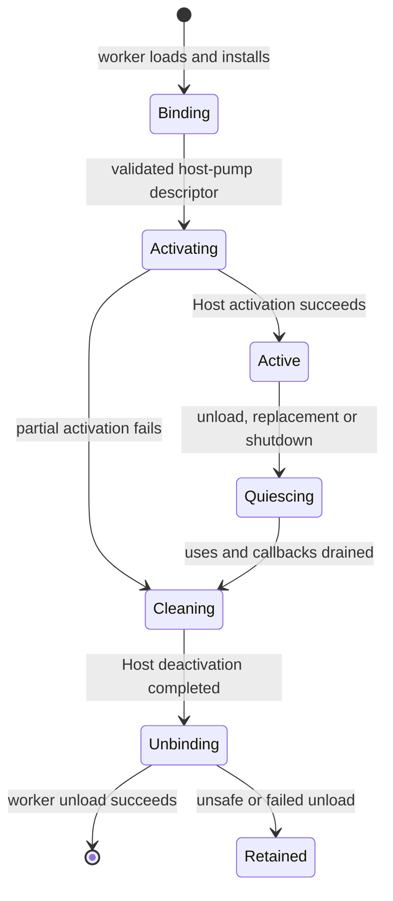

Copyright (c) 2026 Ritchie Brannan / Morphic Void Limited
License: MIT (see LICENSE file in repository root)

File:   platform_host_pumped_design.md
Author: Ritchie Brannan
Drafting and editorial assistance: OpenAI Codex
Date:   30 Oct 2026

# Platform module and host-pumped lifecycle

## Status and scope

This document records the agreed Platform direction, a review of the current
implementation at `f00b2eb`, and a proposed implementation sequence. It does not
describe implemented Platform functionality or authorise implementation. The
current behaviour remains documented in the
[module lifecycle reference](asynchronous_module_lifecycle.md).

The decisions in the next section are agreed. Concrete API names, transport
arrangements and policies introduced later are proposals for review. Outstanding
choices are collected at the end. Audio, external AI communication and the shared
command interface are separate work; they are not added to this implementation.

## Agreed decisions

- Platform owns native windows, HID/input collection and native event handling.
  Executive consumes input through a pipe. Rendering can obtain the native
  window information required for presentation.
- Platform has no service thread. It advertises a host-pumped capability in a
  similar manner to the existing optional service-thread descriptor. Host drives
  it on its main thread; Platform implements native event processing.
- Platform loads only in response to a module request from Executive or Rendering.
  A rendering configuration that only conditions data need not load Platform or
  require a window/display connection.
- Loading/activating Platform and creating/acquiring a window are distinct steps.
  Executive may request a standard window, or Rendering may request one when its
  selected configuration requires presentation.
- Platform owns every window. Executive and Rendering hold explicit uses; neither
  client directly destroys the other's window or owns the Platform binding.
- A client may supply an extension to Platform's window handling. Platform keeps
  its window procedure and standard keyboard/mouse handling. The extension may
  pre-empt eligible handling, including redraw, and otherwise falls through to
  Platform's standard handler.
- Host currently has no blocking wait/wakeup cycle. Host pumping can initially
  fit into that loop; a complete sleep/wake design is separate follow-on work.
- Core retains low-level platform foundations needed to load modules, create
  threads and support the runtime. Platform does not absorb those foundations.
  Core's project include boundary remains Core plus SuiteUTF only.

## Current code and consequences

| Area | Existing implementation | Consequence for this work |
| --- | --- | --- |
| Optional capability | [module_binding.hpp](../../core/module/module_binding.hpp) and [bound_module.cpp](../../core/module/bound_module.cpp), `query_service_thread` | Follow its optional, independently versioned export pattern. Discover a descriptor on the worker; execute host-pumped lifecycle calls on Host. |
| Binding installation | [module_binding_context.cpp](../../core/module/module_binding_context.cpp) | Module installation and thread-local provisioning are separate. A host-pumped call needs valid module-local TLS on the Host thread. |
| Worker authority | [host_worker_thread.cpp](../../host/runtime/host_worker_thread.cpp), `perform_module_work` | Loading, binding, installation and unbinding belong to the I/O worker. Native window creation and destruction must not be added there. |
| Module availability | [module_service.cpp](../../host/runtime/module_service.cpp), `complete`, `complete_thread_start`, `finish` | Readiness currently distinguishes passive bindings from service threads. Add host activation and cleanup states before returning completion. |
| Request admission | [host.cpp](../../host/runtime/host.cpp), `receive_request` and `run` | Executive owns the current module-request route; other registered services send owning requests to the asset service. Rendering cannot yet request Platform through this route. |
| Client lifetime | [module_service.hpp](../../host/runtime/module_service.hpp), `m_client` | A pending operation borrows a `CThreadPackage*`. General routing needs explicit requester-lifetime protection through completion or cancellation. |
| Main loop | [host.cpp](../../host/runtime/host.cpp), `run` | Host drains queues and advances lifecycle, ending in `processor_relax()`. This is a spin hint, not a sleep or OS event wait. Existing queue drains are not budgeted. |
| Thread resources | [CThreadPackage.hpp](../../core/threading/CThreadPackage.hpp) | Transport, parking and native thread state are currently bundled. A pumped module must not pretend to own a native thread just to get an endpoint. |
| Tests | [host.cpp](../../host/runtime/host.cpp), `request_tests`, `complete_tests` | Generic test messages currently resolve only to service-thread packages. A pumped destination requires endpoint-based routing and termination handling. |
| Existing transports | [TRingTransport.hpp](../../core/threading/transports/TRingTransport.hpp), [TQueueTransport.hpp](../../core/threading/transports/TQueueTransport.hpp) | Reuse established transport semantics; an input pipe is not an existing Platform abstraction. Fixed rings reject full writes and require quiescence before deallocation. |
| Type admission | [erased_transport_admission.hpp](../../core/system/erased_transport_admission.hpp) and concrete erased transports | LOCAL identities do not become cross-module messages merely by forwarding them. Choose an explicit shared contract/transport boundary. |
| Unload protection | [asset_service.cpp](../../host/runtime/asset_service.cpp), `CBoundModule::unbind` | Asset acquisitions, dependency bits and allocation attribution do not account for arbitrary window uses or callbacks into another DLL. |
| Shutdown | `CModuleService::request_shutdown` and `CHost::shutdown` | Record-order unload and emergency thread joining need additional dependency-aware quiescence. Platform must remain callable while clients release presentation resources. |

There is no production Platform module or native window/input implementation in
Core, Host, Executive or Rendering to relocate. The current identity catalogue
has no Platform entry. The earlier speculative platform identities were removed;
add only identities required by the actual implementation.

The [architecture model](../architecture/codebase-model.md#platform-and-renderer-coordination)
already assigns windowing and native events to Platform modules and places
coordination in Host. Explicit window uses implement that direction without
making Rendering responsible for loading/unloading another DLL itself.

## Boundaries and proposed files

| Component | Responsibility |
| --- | --- |
| Core | Generic pumped capability, endpoint/lifetime contracts and any genuinely shared transport primitives. No native window or HID implementation. |
| Host | Capability discovery/activation, scheduling, authenticated client identity, completion routing, dependency tracking and orderly teardown. It need not interpret input or window messages. |
| Platform | Window records, native adapters, input translation, pipe ownership, native descriptor publication and extension dispatch. |
| Executive | Application window policy, input consumption and optional window extensions. |
| Rendering | Window acquisition for presentation, native surface integration, resize/redraw response and release after presentation resources are quiescent. |

Proposed layout: `platform/module/binding/`, `platform/module/types/`,
`platform/contracts/`, `platform/runtime/`, and private native adapters under
`platform/native/windows/` and the selected Linux backend directory. The new
top-level module is distinct from existing `core/platform/` support. Check include
resolution explicitly: the shared `platform/platform_defines.hpp` and other Core
paths must continue to resolve correctly. Avoid duplicate relative header names.

Window/input contracts belong to Platform and may be included by its clients.
Host should use generic connection and lifecycle contracts. Native view adapters
can expose the information Rendering needs without placing `HWND`, Linux display
types, graphics handles or Platform payload structures in Core. Rendering creates
and destroys its own graphics presentation objects; Platform supplies windows.

## Proposed host-pumped capability

Use a new optional export, provisionally `morphic_module_host_pump_v1`, returning
a validated, standard-layout function table. Keep bootstrap version 3 unchanged
if the existing core table can support the required context installation; verify
that before freezing the ABI. Absence means this capability is not provided,
while a malformed advertised descriptor fails admission.

The proposed logical operations are:

| Operation | Purpose |
| --- | --- |
| Activate | Install Host-thread call context, initialise module runtime state and publish readiness. Does not implicitly create a window. |
| Pump | Process a bounded amount of queued commands/native events and report idle, progress, quiescent or failure as appropriate to lifecycle state. |
| Begin stop | Close admission to new work and begin cooperative teardown; repeated calls must have defined semantics. |
| Deactivate | Release remaining module runtime resources on the Host thread after clients, callbacks and transports have quiesced. |

These are design roles, not final C++ signatures. Use the established calling
convention, `noexcept`, explicit status returns and engine-owned storage. Supply
a stable Host-owned service context; do not expose `CHost*` or fabricate a
`CThreadResources` containing a nonexistent native thread.

Proposed first-stage capability combinations are passive, service-thread, or
host-pumped. Reject simultaneous service-thread and host-pumped advertisements
until their combined startup/teardown semantics are designed. Executive retains
its special bootstrap role. Platform uses the existing Host thread identity;
it does not need a speculative Platform service-thread identity.

Add an explicit way for a load requester to require host pumping, preserving
`require_service_thread` behaviour and already-loaded capability checks. Whether
this is a second requirement field or a small capability mask is an API checkpoint.
`ModuleResult::available` must mean that every advertised execution capability
has successfully activated. A bound but deactivated module is unavailable even
when worker-side unloading fails.

Activation failure must unwind partial native state on the Host thread before
worker cleanup. Completion retains the original correlation until cleanup has
finished. Discovery on the worker must not create windows or initialise a
thread-affine event connection. Keep binding mutation exclusively with the worker
while its job is in flight; Host must never call an unbinding module.

### Thread-local state and reentrancy

`CBoundModule::prepare_thread` installs ambient thread identity, provisioning and
memory routing for an actual service thread. Review/factor a Host-call preparation
path instead of passing a bogus resource pointer to satisfy its readiness test.
Each module has its own Core/TLS instance. Platform calls on the Host thread and
Executive/Rendering extension calls on that same thread need their own correctly
prepared contexts and allocation attribution.

An extension must not use its service thread's SPSC producer endpoint from Host.
Provide a separate Host-thread producer route or an explicit mailbox with suitable
producer semantics. Likewise, service-thread-owned state cannot become callback
state without a synchronisation and lifetime contract.

Track callback entry depth and defer detach/destruction until calls unwind.
Window creation, native dispatch and destruction may invoke callbacks within
another operation. Do not hold a binding, window-record or transport lock across
foreign callbacks, recursively pump, or synchronously wait for Executive/Rendering
from a Host-thread extension.

## Requests, connections and input pipes

### Module loading and requester lifetime

Route ordinary module load requests from registered service clients through the
same generic admission path. Keep Executive self-unload/replacement and filesystem
authority explicit: another client targeting Executive must not accidentally
trigger the self-transition branch. Enabling Rendering to load Platform does not
implicitly grant every module arbitrary unload/replacement authority.

Initially preserve one outstanding module operation and the existing
acknowledgement/completion protocol. Concurrent loads can return `busy`; accepted
clients handle that explicitly. An `already_loaded` reply still requires matching
identity, requested capability and availability. No automatic load of Platform
is added to Host startup or the conditioning-only Rendering path.

Do not synchronously request and wait for Platform from Rendering's thread-start
handshake. Host currently waits for that startup before completing the load, and
the single module-operation slot would still be occupied. Publish service-thread
readiness first, then acquire dependencies asynchronously. Keep Rendering service
availability distinct from the readiness of a particular presentation session.

Protect the requester instance, its response route and owning request through
completion. If the requester terminates, drain accepted work and retire its route
before freeing its package. A replacement with the same module identity must not
receive its predecessor's reply. Prevent self-targeting transitions and dependency
cycles from leaving a request waiting for its own requester to disappear.

### Proposed connection mechanism

Use a generic, Host-mediated service connection to acquire a Platform endpoint
after module readiness. The load completion may eventually carry such a generic
connection, but should not grow Platform-specific input/window fields.

Proposed sequence: client requests a versioned service connection; Host validates
both live module instances and invokes the provider's connection factory on its
execution thread; the provider returns an opaque endpoint view plus a tracked
connection token. Host returns these through a generic correlated result. Platform
and its clients agree the endpoint layout through Platform-owned headers.

For the first implementation, prefer per-client typed command/result pipes and
a separate input-event pipe. Host tracks identities and connection lifetime while
Platform interprets the commands. Each SPSC pipe has exactly one producer and one
consumer; Executive and Rendering cannot share its producer role. This avoids
turning every Platform command into a Core SYSTEM payload. It also avoids the
incorrect alternative of sending Platform LOCAL payloads through Host's current
erased transports. The exact connection ABI, endpoint storage and close handshake
must be reviewed before implementation; this mechanism is proposed, not existing.

Endpoint buffers have stable addresses and explicit ownership. A failed connection
or reply publication releases the newly reserved endpoint/use. A closed connection
rejects new commands, resolves accepted requests and waits for both endpoint roles
to quiesce before freeing storage. Async slots are interpreted with the connection
instance, not globally across clients.

Check the connection result against existing POD message capacity and layout
rules. Host-to-service communication currently provides a POD route, while the
owning route in `CThreadResources` runs service-to-Host. Do not assume a symmetric
owning reply channel already exists; keep the generic result compact or explicitly
design the necessary transport change.

Executive input consumption is an explicit subscription, including when Rendering
created the window. Do not require Rendering to relay keyboard/mouse data or make
it the input consumer by virtue of requesting window creation. Replacing Executive
requires a new subscription; a stale consumer pointer must never be inherited.

Input records should distinguish physical key transitions, text input, mouse
movement/buttons/wheel, focus and window identity. Device-level HID/raw input,
keyboard layout/IME handling and any wider device classes need a scoped first
contract. Specify ordering, timestamps and coordinate units before freezing it.

A full input pipe must not block the Host thread. Choose an explicit overflow
policy: motion can potentially coalesce, but lost button/key transitions need a
detectable resynchronisation path. The existing fixed ring does not overwrite
unread records. Reserve a reliable way to report overflow/closure rather than
assuming a full pipe can accept its own error event. Capacity and resynchronisation
details remain open.

## Windows, uses and extensions

Proposed operations are create, acquire an existing window, release a use, request
close, attach/detach an extension, and subscribe/unsubscribe input. Creation returns
a window identity and an initial use; acquisition returns a separate use for the
requesting client instance. Window and use identities need stale-generation checks.
Copied native handles are borrowed views, not independently valid ownership tokens.

Keep control authority distinct from a use: a Rendering borrower does not gain the
right to close an Executive-controlled window. Define the controlling client for
each creation route. Close requests stop new acquisitions and notify users;
destruction waits for release. An OS close gesture must pass through this policy
rather than bypass uses through default handling. Window loss from outside the
engine needs a separate invalidation/error path; a use cannot guarantee that the
display server or native environment remains healthy.

Rendering releases graphics resources before its window use. Platform then destroys
the native window on Host after all uses, extensions and active invocations permit
it. Native information should be a versioned/tagged view: Windows needs the agreed
window/instance information, while a selected Linux backend may need display and
surface/window information. Do not assume a single untyped pointer suffices for
every backend or include Vulkan resource ownership in that descriptor.

### Extension dispatch

Platform retains the native window procedure. The proposed ordering is:

1. Perform mandatory input and lifecycle bookkeeping that cannot be suppressed.
2. Offer eligible messages to the registered extension.
3. If unhandled, run Platform's normal behaviour and native default handling.

The result must distinguish handled/unhandled from the native return value;
zero can be a valid handled result. Define the protected message responsibilities
explicitly, including close/destroy and bookkeeping needed around resize/focus.
An extension can pre-empt redraw and other eligible messages without replacing
keyboard/mouse handling or bypassing window-use protection.

For painting, specify who validates/acknowledges the native paint request even if
the extension only schedules Rendering work. An asynchronous redraw request is
not by itself a complete native paint-handling contract. The standard window must
remain usable with no extension and no renderer.

An extension registration is separate from a window use. It contains a provider
module instance, callable entry, context lifetime and a detach protocol. Hold a
binding dependency until the extension is unreachable and active invocations have
returned. Context storage must survive independently of service-thread locals.
Detach acknowledgement is the point after which its code/context may be released.
Neither pointer validity nor allocation attribution alone proves callback safety.

Initially propose one optional extension per window. Multiple observers or ordered
extension chains require separate semantics and are not implied. Native message
arguments are borrowed for the duration of dispatch; do not queue raw pointers
from them to another thread. Linux event translation and extension eligibility
must be defined without pretending that every Win32 message has an equivalent.

## Host pumping, teardown and failures

Pump registered capabilities in a stable, fair order during `CHost::run`, including
the stages of shutdown in which clients still need Platform. Bound each engine
work slice and native-event batch; report more work for a later iteration. Audit
the existing unbounded queue drains so sustained traffic cannot starve native
events, input delivery or lifecycle completion. This bounds engine scheduling,
not the duration of every native operation or third-party callback.

The first stage retains the current spin loop. Do not insert a blocking native
message loop or arbitrary sleep inside Platform. Later sleep/wake integration
must consider module/worker messages, input/native events, lifecycle progress,
deadlines and shutdown together, including the no-Platform case and lost-wakeup
races. Existing worker parking is not already a Host event multiplexer.

Track generic module-instance dependencies for connections and installed callbacks;
Platform separately tracks its window uses. This permits bidirectional dependencies
(Rendering uses Platform; Platform can call a Rendering extension), so a simple
reference count or catalogue-order unload is insufficient. Use staged quiescence:

1. Close admission for the affected transition and announce withdrawal where needed.
2. Keep Platform pumping while clients drain work and release native presentation
   resources. Continue routing releases and accepted completions while closing.
3. Detach affected extensions and input endpoints before their provider/client
   state disappears. Executive replacement removes only the outgoing instance's
   attachments and uses; independent Rendering uses and windows may survive.
4. Once borrowers and active callbacks are gone, finish window destruction and
   endpoint cleanup on Host, then deactivate the pumped service.
5. Dispose dependent retained assets and finish other existing guards before
   allowing worker-side unbind. Do not issue any callback after that handoff.

Ordinary unload/replacement with unrelated live users should initially reject with
a clear busy/in-use result instead of waiting indefinitely while monopolising the
single module-operation slot. Full shutdown coordinates all clients rather than
waiting for that rejection to resolve itself. Any future forced revocation must
still preserve native-resource and callback lifetime obligations.

Terminal client cleanup requires evidence that its service thread, callback routes
and endpoint roles are quiescent. Releasing a window use on thread termination
alone is unsafe if an extension remains installed or presentation resources remain
live. The failure path must not fabricate successful release. Preserve unsafe-to-
unload bindings until process exit and report failure where safe teardown cannot
be established, consistent with the existing retained-DLL fallback.

Review emergency `CHost::shutdown` separately: its present join-all-threads-first
path can deadlock if a service is waiting for a pumped release completion. Keep
required Host work progressing during cooperative joins, or provide an explicit
failure/cancellation path that lets the service exit before retaining the binding.
Failed activation, failed reply delivery and module pump failure need the same
explicit lifetime accounting as successful unload.

## Native implementation constraints

Windows window creation, event dispatch and destruction belong to Host's main
thread. Microsoft documents the creating thread's message-loop responsibility and
the same-thread requirement for destruction. Native dispatch can be reentrant:
`PeekMessage` also dispatches incoming sent messages. Prepare records and callback
guards before native calls, including creation/destruction, rather than assuming
callbacks occur only in the explicit pump loop.
See [window threads](https://learn.microsoft.com/en-us/windows/win32/procthread/creating-windows-in-threads),
[DestroyWindow](https://learn.microsoft.com/en-us/windows/win32/api/winuser/nf-winuser-destroywindow)
and [PeekMessageW](https://learn.microsoft.com/en-us/windows/win32/api/winuser/nf-winuser-peekmessagew).

Linux still requires native event dispatch even though it does not use the Win32
message-pump model. Select the supported window-system backend before specifying
its descriptor, dependencies or wait integration. For example, Wayland exposes
display event queues and a file descriptor for event-loop integration; this is
an illustration, not a decision to choose Wayland.
See the [Wayland client API](https://wayland.pages.freedesktop.org/wayland.freedesktop.org/docs/html/apb.html).

Absence of a display must not break conditioning-only runs. Separate tests using
a simulated native adapter from tests requiring a real/virtual display. Linux
compilation and headless lifecycle tests do not establish working native window
support. Report missing native coverage explicitly until the chosen backend is
tested. No Linux backend or new third-party window library is selected here.

## Implementation sequence and review checkpoints

This sequence is planning only; later implementation follows the scope authorised
by the user. Exit criteria are future validation requirements, not claims of
completed tests.

| Stage | Changes | Exit criteria |
| --- | --- | --- |
| 1. Freeze contracts | Review descriptor operations/results, connection ABI, module-instance dependencies, window/use identities and extension detach rules. Choose Linux backend and initial input scope before native work. | Trace successful load, failed activation, caller exit, close with two users, Executive replacement and full shutdown without dangling pointers or cyclic waits. |
| 2. Generic pumped lifecycle | Extend Core binding helpers and Host records/state machine; add context preparation, bounded pumping, activation cleanup and worker-only unbind. Use a fixture with no OS windows. | Passive and threaded behaviour preserved; invalid descriptors, mixed capabilities, partial activation, pump failure and stop ordering covered. |
| 3. Client routes and dependencies | Admit ordinary service load requests, protect requester instances, add service connections and dependency-aware detach. Extend generic test routing to pumped endpoints. | Rendering-initiated load, concurrent/busy load, requester death, stale replies, closure and callback-provider replacement covered without deadlock. |
| 4. Platform shell and Windows windows | Add module binding/project/catalogue/policy integration, standard window implementation, explicit uses and native descriptor views. | No automatic load; load without a window; create/acquire/release; invalid/stale IDs; close waits for both users; missing display/native failure has explicit results. |
| 5. Input and extensions | Add Executive input subscription, standard keyboard/mouse/text translation and extension registration/fall-through. | Input remains available when extensions handle eligible messages; overflow/resynchronisation, detach during dispatch, provider replacement, paint completion and no-extension behaviour covered. |
| 6. Rendering and Linux integration | Exercise window acquisition from Rendering's presentation configuration, retain conditioning-only path, implement selected Linux native adapter. | Both request origins work; release ordering verified; no renderer-specific Host branch; native window/input smoke tests pass on Windows and selected Linux backend. Actual Vulkan rendering remains separate work. |
| 7. Full qualification and references | Run clean platform matrices and lifecycle/acceptance suites; update implemented references after behaviour exists. | Existing coverage preserved, new failure/teardown cases pass, native coverage distinguished from headless coverage, retained-binding failures observable. |

### Build, policy and test integration

- Add `MorphicPlatform` project/shared items/filters and solution configurations,
  matching the current Debug/Development/Release project conventions. Preserve
  Visual Studio-managed CRLF/BOM/final-newline conventions. Include the optional
  export's Win32 calling-convention alias as well as x64/Linux visibility.
- Update `CMakeLists.txt`: its module/executable classification currently names
  Executive and Rendering explicitly. Add Platform as a shared module with the
  same basename/native extension and appropriate private native dependencies.
  Keep deployment build dependencies distinct from unconditional runtime loading.
- Add only a required Platform mount/module identity and actual shared service
  contract identities. Clean-build all binaries and fixtures after catalogue/ABI
  changes. Do not restore speculative platform variants or a nonexistent thread.
- Update `policy/morphic_policy.cfg` scan roots and narrowly scoped native-header
  rules. Extend module-relative include resolution in the validator, which
  currently enumerates Host, Executive and Rendering. Add resolver regression
  cases while preserving Core/SuiteUTF enforcement. Audit other explicit component
  lists in build/source extraction and tests.
- Add Platform to test source manifests and isolated runtime/deployment setup as
  appropriate. New native tests must not silently open windows in ordinary asset
  acceptance runs or make headless CI depend on a desktop session.
- Existing Windows CI builds Debug/Release x64/Win32 and runs ordinary, Host worker
  and lifecycle suites with one/two workers. Extend those fixtures for pumping,
  requester lifetimes, window uses and callback dependencies.
- Linux CI builds GCC/Clang Debug/Release and runs CTest. It does not currently run
  the Windows lifecycle fixture harness. Add portable pumped-lifecycle coverage
  and explicit native-display jobs/harness support; do not claim Windows fixture
  coverage automatically applies on Linux.
- Exercise generic `RunTestsRequest` on a pumped fixture/Platform endpoint without
  introducing a service thread. Preserve busy/rejection, correlation, final-reply
  precedence, failed-provider completion and caller-lifetime rules.
- For changes to shutdown, include a client waiting for a Platform release reply
  when shutdown begins, an extension executing as detach is requested, failed
  activation after allocating a native resource, failed endpoint publication,
  Executive replacement with a Rendering-held window, and Platform unload with
  live users. Verify release/detach/deactivate/unbind order, not just exit status.

## Remaining decisions

| Decision | Proposed starting point / constraint |
| --- | --- |
| Pump ABI and context | Optional versioned table; explicit Host-call context; no fake thread package. Confirm activation/stop status and budgeting fields. |
| Service connection ABI | Host-mediated per-client typed endpoints, with generic instance/lifetime tokens. Review storage, publication and close acknowledgements before coding. |
| Load versus unload authority | Enable service clients to load dependencies; retain explicit control over Executive and unload/replace. Define ordinary client permissions. |
| Native Linux backend | Not selected. Decide X11/XCB, Wayland or another deliberate adapter and the CI display environment. |
| Initial HID scope | Keyboard/mouse and text entry are required; raw device APIs, device enumeration, IME breadth and additional HID classes need explicit scope. |
| Window control | Platform owns storage; clients hold uses. Specify controlling-client transfer and the default close policy when that client exits. |
| Extensions | Propose one extension per window, explicit protected duties and handled/native-result fields. Finalise message eligibility, paint duties and callback context ownership. |
| Input transport | Choose bounded capacity, motion coalescing and reliable overflow/resynchronisation semantics. Define subscription handover at Executive replacement. |
| Stop/failure policy | Cooperative drain with explicit in-use rejection for ordinary unload; retain unsafe bindings on terminal failure. Define cancellation/deadline diagnostics without unsafe forced unload. |
| Host waiting | Deferred. Preserve a future wake-source integration point without declaring a wait ABI or adding arbitrary sleeps in this stage. |

## Review record

The documentation pass reviewed binding/context installation, Host worker and
module state machines, request/test routing, shutdown, transport admission, the
identity catalogue, policy configuration, Visual Studio/CMake integration and
Windows/Linux CI definitions. Only documentation is changed by this pass. No
Platform code, project, dependency, runtime capability or test has been added,
and the existing build matrices have not been rerun for this design document.
